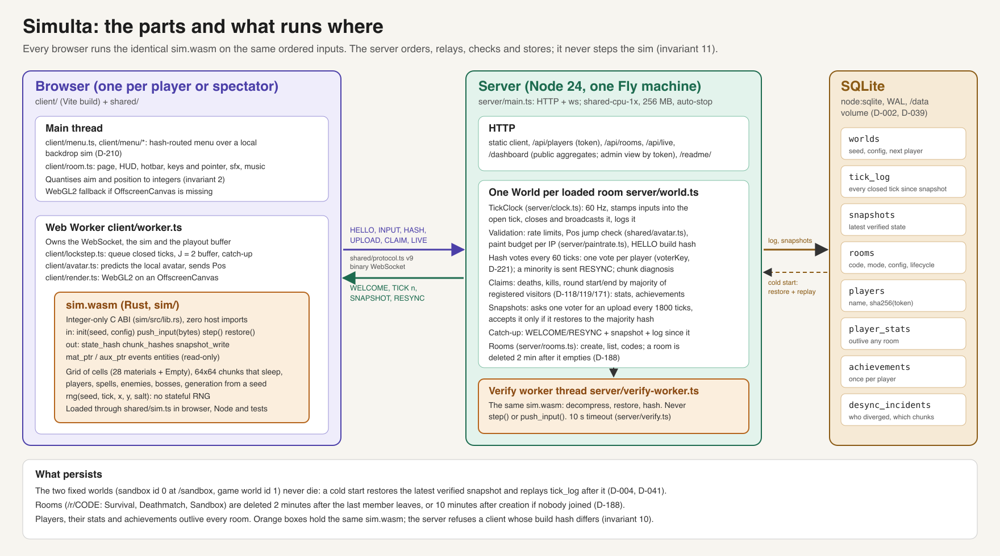
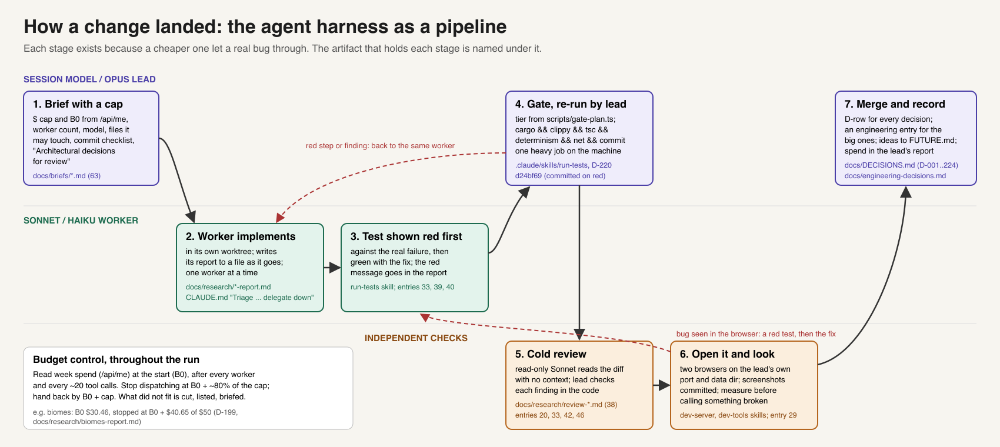

# Simulta: architecture and engineering decisions

A guide for a marker, readable in about 15-20 minutes. It describes the code as it stands at `multa` commit
`b630cff` (8 Nov 2026) and links out to the detail rather than repeating it. Every claim points at a file, a decision
row (`D-123`, in [`docs/DECISIONS.md`](docs/DECISIONS.md)), an engineering entry ([entry 1](docs/engineering-decisions.md#1-server-paced-deterministic-lockstep), in
[`docs/engineering-decisions.md`](docs/engineering-decisions.md)), a research note or a commit (`git show <hash>`).
Where the record was wrong and later corrected, this guide follows the correction.

**Contents.** [1 What Simulta is](#1-what-simulta-is) ·
[2 System architecture](#2-system-architecture) ·
[3 The invariants and how each is enforced](#3-the-invariants-and-how-each-is-enforced) ·
[4 Key engineering decisions](#4-key-engineering-decisions) ·
[5 Harness and skill-level interventions](#5-harness-and-skill-level-interventions) ·
[6 Known limits and open issues](#6-known-limits-and-open-issues) ·
[7 Map of the documentation](#7-map-of-the-documentation)

## 1. What Simulta is

Simulta is a multiplayer falling-sand game in the browser, in the style of Noita and Sandspiel. Up to eight people
share one world of cells (sand, water, fire, lava, oil, acid, ice, plants and 20 more materials, `sim/src/materials.rs`)
that falls, flows, burns and reacts. There is a permanent shared sandbox for painting, and rooms with avatars, spells and
enemies: co-op Survival down to a boss, PvP Deathmatch and sandbox rooms (`server/rooms.ts:21`, `shared/room.ts:54-70`).

**The one idea that shapes everything is deterministic lockstep.** Every client runs the identical `sim.wasm` (Rust
compiled to WebAssembly) on the same ordered inputs and so computes the same world, cell for cell. The server never
simulates: it keeps the clock, orders inputs into ticks, relays them, and checks that clients agree. A world of up to
2048 x 1536 cells (`shared/room.ts:47-51`) therefore costs the network only its inputs, a few bytes each, and the
server runs on Fly's smallest machine. The price is that any nondeterminism (a float, a hash map's order, a clock read,
an uninitialised byte) splits the room, so most of the engineering below is about making that impossible or detectable.
The design is in [`docs/plan.md`](docs/plan.md) section 3 and the reasoning in [entry 1](docs/engineering-decisions.md#1-server-paced-deterministic-lockstep) and [entry 4](docs/engineering-decisions.md#4-every-client-simulates-the-server-only-checks).

## 2. System architecture

### 2.1 The parts



*Source: [`docs/architecture/components.svg`](docs/architecture/components.svg). The older networking diagram,
[`docs/lockstep-networking.png`](docs/lockstep-networking.png), still shows the tick timeline well, but its storage
box says "Fly Postgres": the project uses SQLite on the Fly volume instead (D-002).*

| Part | Code | What it does |
|---|---|---|
| **Simulation** | `sim/` (Rust, about 10,250 lines in `sim/src/`) | The whole game state and every rule: the cell grid and 64 x 64 chunks (`grid.rs`), players, spells, projectiles, bags and pickups (`entities.rs`, `spells.rs`), enemies and bosses (`enemy.rs`), world generation from a seed (`gen.rs`), counter-based randomness (`rng.rs`), hashing and snapshots (`hash.rs`, `snapshot.rs`). Exposes an integer-only C ABI (`lib.rs`: `init`, `push_input`, `step`, `state_hash`, `chunk_hashes`, `snapshot_write`, `restore`, read-only views). |
| **Shared** | `shared/` | Code both sides import: the typed wasm loader (`sim.ts`), the binary protocol, version 9 (`protocol.ts`), input encodings (`inputs.ts`), the 16-byte room config (`room.ts`), the avatar's Pos rule (`avatar.ts`), achievements, stats and the server event catalogue. |
| **Client** | `client/` | The main thread draws the menu (`menu.ts`, `menu/`) and the room page (`room.ts`: HUD, hotbar, input, sound). A Web Worker (`worker.ts`) owns the WebSocket, the sim and the playout buffer (`lockstep.ts`), predicts the local avatar (`avatar.ts`) and renders with WebGL2 into an OffscreenCanvas (`render.ts`); the main thread renders instead when OffscreenCanvas is missing (`room.ts:1366-1373`). |
| **Server** | `server/` (Node 24) | `main.ts` serves HTTP (the client, `/api/players`, `/api/rooms`, `/api/live`, the dashboard, `/readme/`) and the WebSocket. One `World` per loaded room (`world.ts`) holds the tick clock (`clock.ts`), the closed-tick log, hash votes, claims and snapshots. A worker thread (`verify-worker.ts`) restores uploaded snapshots in the same `sim.wasm` to check them. SQLite through `node:sqlite` (`db.ts`). |
| **Deploy** | `Dockerfile`, `fly.toml` | A three-stage image (Rust to `sim.wasm`, Vite client build, `node:24-slim` runtime) on one `shared-cpu-1x` machine with 256 MB and a 1 GB volume at `/data`, stopped when idle (`fly.toml`; D-002, D-003, D-008). |

### 2.2 How a tick flows from an input to every screen

```mermaid
sequenceDiagram
    autonumber
    participant A as Browser A (worker + sim.wasm)
    participant S as Server World (server/world.ts)
    participant B as Browser B (worker + sim.wasm)
    participant DB as SQLite
    A->>A: key or pointer; aim and position quantised to integers
    A->>S: INPUT (Paint, Cast, Ready) or Pos every 2 ticks
    S->>S: validate (rate limit, Pos jump check, paint budget per IP), stamp into the open tick
    Note over S: TickClock closes tick k at 60 Hz
    S-->>A: TICK k (every input in order)
    S-->>B: TICK k
    S->>DB: tick_log, flushed about once a second
    A->>A: hold J = 2 ticks, then push_input each input in order, step()
    B->>B: the same: same inputs, same order, same world
    A->>S: HASH every 60 ticks (B too)
    S->>S: majority per voter (one vote per player, D-221)
    S-->>B: RESYNC if B disagrees (snapshot + log), plus a chunk-hash diagnosis
    S->>A: REQUEST_SNAPSHOT every 1800 ticks (a voter only)
    A->>S: SNAPSHOT_UPLOAD
    S->>S: verify worker restores it; accepted only if it hashes to the majority
    S->>DB: snapshots; tick_log before it dropped
```

- **The clock and the log.** Ticks are numbered from 1; applying closed tick k means "push its inputs, then step",
  leaving `sim.tick() == k` (D-030, `server/clock.ts:1-2`). A 4 ms timer closes every tick whose time has passed
  (`server/main.ts:81`, D-035) and `World.onClosed` broadcasts it before any bookkeeping (`server/world.ts:586-591`).
- **The client's playout.** The worker keeps a buffer of `J = 2` ticks (`client/lockstep.ts:17`), steps by the real
  time owed rather than a fixed count per frame (D-215), and fast-forwards when more than two seconds behind (D-177).
  The local avatar is predicted at once and reported as an integer `Pos` (`Avatar.quantised`, `client/avatar.ts:209-211`; sent at `client/worker.ts:586`); everything else
  waits for the server's tick, so a world action lands after about the round trip plus three ticks ([entry 5](docs/engineering-decisions.md#5-the-networking-ticks-playout-protocol-versions)).
- **The sim's step order** is fixed in `Sim::step` (`sim/src/sim.rs:207-251`; its doc comment and D-102 list the first
  six): inputs, lobby, entities, active region, cells, explosions, hazards, round end, then falling islands.
- **Joining late.** WELCOME carries the room's seed and 16-byte config (D-142); the joiner generates the world, restores
  the latest verified snapshot and replays the log after it (`World.join`, `server/world.ts:676`). When nobody in the world
  is live, the clock holds while a joiner with a log to replay catches up (D-122); a joiner with nothing to replay
  never holds it (D-131).

### 2.3 How state is checked

Lockstep has no authority that knows the right answer, so the server checks agreement instead.

- **Hash votes.** Each client sends its state hash every 60 ticks (`HASH_EVERY`, `shared/protocol.ts:66`). The server
  takes the majority **per voter**, not per socket: one vote per registered player in worlds with avatars, one per IP
  tag in the sandbox, none for spectators (`World.voterKey`, `server/world.ts:1029-1032`; D-221). Anyone who disagrees
  is sent RESYNC; three resyncs in a minute closes the socket (`RESYNC_BUDGET`, `server/world.ts:103`). This rule was
  per socket until 8 Nov, when a code-only review showed that three spectator tabs could outvote the players ([entry 46](docs/engineering-decisions.md#46-an-outside-readers-review-and-who-gets-to-decide-the-truth)).
- **Chunk diagnosis.** On a divergence the server asks both sides for per-chunk hashes and records which 64 x 64
  chunks differ in `desync_incidents`, shown on the admin dashboard (D-126).
- **Snapshots.** Every 1800 ticks the server asks one live voter for a snapshot (`requestSnapshot`,
  `server/world.ts:1493`), holds the upload until the majority hash for that tick is known, then restores it in the
  verify worker and stores it only if it hashes to that majority (`checkUpload`, `server/world.ts:1528-1576`; D-040,
  D-071, D-112). Restore never steps the sim (invariant 11).
- **Claims.** The server cannot see a death, so clients report deaths, enemy kills and round ends from the sim's
  events, and the server acts on a majority of registered visitors, counting each visitor once (D-118, D-119, D-121,
  D-171). Stats and achievements come only from resolved claims ([entry 23](docs/engineering-decisions.md#23-an-achievement-the-sims-outputs-cannot-express)).
- **Input validation.** A rate limit per connection (D-033), a Pos jump check per player and life
  (`shared/avatar.ts`, D-078, D-079), a per-IP paint rate on the server and a deterministic paint work budget inside
  the sim (D-223), and a refusal of any client whose protocol version or `sim.wasm` hash differs
  (`server/main.ts:1340-1341`).

### 2.4 What persists and what doesn't

| Thing | Lives | Evidence |
|---|---|---|
| The two fixed worlds: the sandbox at `/sandbox` (world 0) and the game world (world 1) | Forever. A cold start (the machine stops when idle) restores the latest verified snapshot and replays `tick_log` after it. | D-004, D-041, D-064; `server/rooms.ts:185`; [entry 6](docs/engineering-decisions.md#6-persistence-on-a-machine-that-stops-when-idle) |
| Unowned rooms at `/r/<code>` (Survival, Deathmatch, Sandbox) | Deleted 2 minutes after the last member leaves, or 10 minutes after creation if nobody joined. Survival and Deathmatch are deliberately ephemeral. | D-188, `server/main.ts:104-106`, `server/rooms.ts:171-201`; [entry 35](docs/engineering-decisions.md#35-rooms-that-die-when-empty-and-why-empty-now-is-the-wrong-test-at-boot) |
| Players (name, `sha256(token)`), `player_stats`, `achievements` | Outlive every room and every world reset. | D-065, D-091, D-115; `server/db.ts` |
| A player's own sandbox (one per player, shared by link; anyone with the link paints) | Until its owner deletes it (`DELETE /api/sandbox/:code`, owner's token only). The sweep and the public list skip owned rooms; an empty one unloads and reloads from its snapshot and log. At most 200 in total. | D-225; `server/rooms.ts:177`, `server/main.ts:113`, `server/main.ts:937`; [entry 47](docs/engineering-decisions.md#47-a-world-that-persists-because-someone-owns-it) |
| Snapshot format | Version 19. Restore refuses any other version, so each generation change resets stored worlds; acceptable because the game is not yet declared live. | `sim/src/snapshot.rs:9-11`; D-194 |

## 3. The invariants and how each is enforced

[`CLAUDE.md`](CLAUDE.md) states eleven invariants for the sim; breaking one needs the user's approval. Most are enforced
by a machine check, not by good intentions:

| # | Invariant | Enforced by |
|---|---|---|
| 1 | All logic that affects shared state lives in `sim/`; TypeScript writes sim state only through `push_input` | `shared/sim.ts` exposes only read-only views of the grid (D-029, which replaced a monkey-patch); the verify worker only restores and hashes (`server/verify-worker.ts:1-3`). Held by structure and review; no test checks it directly. |
| 2 | The ABI takes and returns integers only | Every export in `sim/src/lib.rs` is `u32`/`i32`; aim is quantised in TypeScript (`quantiseAngle`, `client/spells.ts:46`) and Pos to 1/16 cell (`client/avatar.ts:209-211`); the room config is 16 bytes (D-132). |
| 3 | No floating point in `sim/` | `#![deny(clippy::float_arithmetic)]` (`sim/src/lib.rs:2`), clippy with `-D warnings` on wasm32 in the gate and as test D11 (`tests/determinism/static.test.ts:33`). Fixed-point trig comes from a generated table (`sim/src/trig.rs`, D-075). |
| 4 | No host imports | `WebAssembly.Module.imports(sim.wasm)` must be empty (`tests/determinism/static.test.ts:26-27`). A `canary` build adds exactly one import and must be caught (D10), which proves the check can fail (`sim/Cargo.toml`, `sim/src/sim.rs:242`). |
| 5 | No `HashMap`/`HashSet`, clocks, threads or entropy | `sim/clippy.toml`: `disallowed-types` for both hash collections and `disallowed-methods` for `Instant::now` and `SystemTime::now`. |
| 6 | Randomness is counter-based | One pure function, `rng(seed, tick, x, y, salt)` (`sim/src/rng.rs:9`), with one salt per use. New salts must be unique (`salts_are_unique`, `sim/tests/structures.rs:295`); eight older ones are known duplicates (D-217). |
| 7 | Hash fixed-width integers only | Hashes run over the `u8` planes (`sim/src/hash.rs`). Test D3 compares native Rust with wasm32 hash logs, which differ if anything depends on `usize` (`tests/determinism/static.test.ts:8,17`). |
| 8 | Chunk sleeping is semantically invisible | Sleep on and off must produce the same hashes: `sim/tests/sleep.rs`, D7 in `tests/determinism/sleep.test.ts`, the restore case in `sim/tests/wake.rs`, and the hash-cache test `sim/tests/hash_cache.rs` (D-224). [entry 8](docs/engineering-decisions.md#8-chunk-sleeping-that-must-be-invisible), [entry 33](docs/engineering-decisions.md#33-waking-the-frozen-world-and-the-restore-that-would-have-split-it). |
| 9 | Outputs never feed back as inputs | `events`, `entities` and the chunk-hash ring are read-only (`client/lockstep.ts:30`); the menu backdrop's camera windows are chosen offline, never from live entity positions ([entry 43](docs/engineering-decisions.md#43-the-menus-mobs-are-real-because-the-menu-plays)). Held by review. |
| 10 | All clients in a world run the identical `sim.wasm` | The server hashes its wasm at start and refuses a HELLO with another hash (`server/main.ts:1341`); the `dev-server` skill exists because this bites after every rebuild. |
| 11 | No server-side stepping, P2P, rollback, wasm threads or cell ownership | The server imports the sim only in the verify worker, which never calls `step` or `push_input` (`server/world.ts:1-3`, `server/verify.ts:3`). |

**The determinism suite** (`pnpm test:determinism`, [entry 7](docs/engineering-decisions.md#7-a-determinism-harness-before-any-game-code) and [entry 40](docs/engineering-decisions.md#40-the-gate-how-a-lockstep-game-is-tested-and-what-the-tests-kept-missing)) runs the same input
scripts in Node, Chromium, Firefox and WebKit (`tests/determinism/browser.test.ts:44-46`, D2) and natively (D3), checks
imports (D11) and the canary (D10), and compares sleep on and off (D7). Pinned hashes (`sim/tests/golden.rs`,
`sim/tests/perf_equiv.rs`) make any change in results a deliberate re-recording, listed in the commit (D-191 moved all
but one). **Agreement is not coverage:** the cross-browser "D2 with casts" test once passed while no cast ever
succeeded, so tests now assert what happened before trusting agreement ([entry 22](docs/engineering-decisions.md#22-a-cross-browser-check-that-tested-nothing-it-named), D-114).

## 4. Key engineering decisions

The full log has 223 rows; [`docs/engineering-decisions.md`](docs/engineering-decisions.md) tells 47 of them as
stories. These are the ones that shaped the architecture or cost real time, including the reversals and the bugs that
taught something.

**Simulation**

| Decision | Why | Links |
|---|---|---|
| Server-paced lockstep, Rust in wasm, hard rules from day one | Bandwidth independent of world size; a small server; determinism made a property of the build, not of care | [entry 1](docs/engineering-decisions.md#1-server-paced-deterministic-lockstep), [entry 2](docs/engineering-decisions.md#2-a-rust-simulation-in-webassembly-with-hard-rules); D-006 |
| A determinism harness (four engines, native, canary) before any game code | Every later change is judged against it | [entry 7](docs/engineering-decisions.md#7-a-determinism-harness-before-any-game-code); D-019, D-020 |
| Counter-based RNG with one salt per use | No RNG state to snapshot or desync; order-independent | [entry 3](docs/engineering-decisions.md#3-counter-based-randomness); D-217 (eight duplicated salts, left as a correlation) |
| A 16-byte `RoomConfig` replaced the `world_kind` byte, hashed into the state | Per-room rules; two clients with different configs diverge at tick 0 instead of agreeing silently | [entry 11](docs/engineering-decisions.md#11-a-config-replaces-the-world-kind-and-ends-a-compatibility-guarantee); D-132, D-133 |
| Chunk sleeping, then frozen chunks that wake (no cap) | Big worlds at 60 Hz; a flood you walk away from finishes. The first restore test could not fail; the cold review found the split | [entry 8](docs/engineering-decisions.md#8-chunk-sleeping-that-must-be-invisible), [entry 33](docs/engineering-decisions.md#33-waking-the-frozen-world-and-the-restore-that-would-have-split-it); D-054, D-176 |
| **Reversal:** cells update row by row across a band of chunks (D-191) | The user's screenshot of water standing in walls 64 cells apart. Not the active region, as D-173 had concluded for the same symptom: chunk-major order gave edge cells fewer moves per tick | [entry 39](docs/engineering-decisions.md#39-the-water-walls-were-the-scan-order-not-sleeping); D-173, D-191 |
| Every input has a bounded cost; then a per-tick paint work budget inside the sim | One huge Paint froze every client (`3094d25`); later a review showed many small paints could too | D-223; `sim/src/tuning.rs:399-408` |
| Falling rock: crumbling v0, falling islands v0.5; full rigid bodies researched and not built | A rigid body in an integer lockstep sim costs more than the remaining time; v0 floated a block that every test passed | [entry 28](docs/engineering-decisions.md#28-rigid-bodies-falling-rock-in-a-lockstep-integer-sim-researched-not-built), [entry 29](docs/engineering-decisions.md#29-green-tests-broken-features-and-once-a-wrong-alarm-what-the-browser-caught-overnight); D-165, D-190, D-192 |

**Networking and trust**

| Decision | Why | Links |
|---|---|---|
| Every client simulates; the server only checks hashes and verifies snapshots | Keeps invariant 11; the server can still refuse a bad snapshot | [entry 4](docs/engineering-decisions.md#4-every-client-simulates-the-server-only-checks); D-038, D-040, D-045 |
| **Bug that taught:** hash votes counted sockets, not players (D-221) | Three spectator tabs could get every player resynced and become the snapshot source. Claims had counted visitors since D-119; hashes never did | [entry 46](docs/engineering-decisions.md#46-an-outside-readers-review-and-who-gets-to-decide-the-truth); D-221, D-222 |
| Pos checked per player and per life | A cold review found a two-message teleport through D-073's respawn rule | [entry 20](docs/engineering-decisions.md#20-what-independent-reviews-caught-that-tests-missed); D-078, D-079 |
| Deaths and kills by majority claim | The server never steps, so it cannot see a death | [entry 23](docs/engineering-decisions.md#23-an-achievement-the-sims-outputs-cannot-express); D-118 to D-121 |
| Pause the world while a lone joiner catches up (after OpenTTD's `pause_on_join`) | A long log made a joiner chase a moving target | [entry 16](docs/engineering-decisions.md#16-snapshot-timing-and-the-correction); D-122, D-131 |
| A slow player gets a notice; the room is not touched | Measured through a frame proxy at 300-2000 ms RTT, loss and blackouts: the server held 60 ticks/s and the other player was unaffected | D-226; [`slow-net-report.md`](docs/research/slow-net-report.md) |
| Step by real time owed, not a fixed count per frame | A bisect blamed a CSS commit; the cause was that the worker's rAF ran at 3-9 Hz on a throttled page | D-215; [`n1-throttled-regression.md`](docs/research/n1-throttled-regression.md) |

**Persistence**

| Decision | Why | Links |
|---|---|---|
| SQLite (WAL) on the one Fly volume, not Postgres | One machine and one volume in the course setup | D-002, D-039 |
| Cold start = restore the latest verified snapshot + replay the log | The machine stops whenever it idles | [entry 6](docs/engineering-decisions.md#6-persistence-on-a-machine-that-stops-when-idle); D-004, D-041 |
| **Outage:** the live sandbox went down on 18 Oct | `push(...frames)` overflowed the stack once the log passed about 130,000 ticks, because snapshots had stopped for days | [entry 15](docs/engineering-decisions.md#15-the-live-site-went-down-on-18-october), [entry 16](docs/engineering-decisions.md#16-snapshot-timing-and-the-correction); D-099, D-100, D-101 |
| Keep the generated world in the sim to skip regeneration on restore | Restore cost; it later made verifies slow with many rooms (D-213) | [entry 17](docs/engineering-decisions.md#17-the-late-join-test-that-failed-after-the-world-cache); D-088 |
| Rooms die when empty; random 64-bit room seeds | Rooms piled up forever; then every new room looked the same because sqlite reused ids | [entry 35](docs/engineering-decisions.md#35-rooms-that-die-when-empty-and-why-empty-now-is-the-wrong-test-at-boot); D-188, D-201 |
| A world persists because someone owns it | The marking criteria ask for persistence; game rooms are ephemeral by design, so a player's own sandbox is the exception, deleted only by its owner | [entry 47](docs/engineering-decisions.md#47-a-world-that-persists-because-someone-owns-it); D-225 |

**Generation and content**

| Decision | Why | Links |
|---|---|---|
| Biomes as sites on the guaranteed cave path | The generator's two guarantees (a walkable path down, an intact arena) and their tests stay unchanged | [entry 41](docs/engineering-decisions.md#41-biomes-on-a-50-budget-and-the-mine-that-floated); D-193 |
| **Bug:** the mine floated, then had no wood at all | A "never floats" test passed when nothing was placed. "A never-wrong invariant needs a sometimes-right partner" | [entry 41](docs/engineering-decisions.md#41-biomes-on-a-50-budget-and-the-mine-that-floated) (with its correction); D-200, D-203 |
| **Bug:** the boss supply alcove was 2 rows too short | Its pickups were unreachable in every Survival world for a 10-row avatar | D-214; `sim/tests/pickup_reach.rs` |
| The sky's ground line from the generated world, not live cells | Live solids moved the line; snow and walls showed cave wall in stripes. Then a ruin's Brick drew cave wall inside every house, seen only in a screenshot | D-202, D-211, D-216; [entry 45](docs/engineering-decisions.md#45-a-surface-you-can-read-and-what-only-a-screenshot-saw) |
| One boss per world, chosen from the seed; a second boss kind | "The boss" meant kind 4 in the server and client, so a Colossus kill counted for nothing | [entry 42](docs/engineering-decisions.md#42-three-stale-branches-in-an-afternoon-and-the-second-boss); D-205, D-206 |

**Client and performance**

| Decision | Why | Links |
|---|---|---|
| Sim and WebGL2 renderer in a Web Worker on an OffscreenCanvas | The main thread stays free for input and UI | `client/worker.ts:1-2`; plan section 8 |
| Camera, zoom, sky, ambient life and ice sliding are client-only | Cosmetics that cannot desync because they are never read back | D-055, D-085, D-196, D-212 |
| The renderer is told the terrain, not left to guess from the height | Small cave rooms filled with sky | [entry 36](docs/engineering-decisions.md#36-the-renderer-that-guessed-what-kind-of-world-it-was-drawing); D-189 |
| The menu backdrop is a real local sim with real mobs | Enemies only move near a live player, so a camera alone shows a frozen world | [entry 43](docs/engineering-decisions.md#43-the-menus-mobs-are-real-because-the-menu-plays); D-210 |
| Phones play; one backing pixel per cell on touch devices | Cost was the fragment shader per device pixel, not the sim | D-209, D-218 |

**Capacity**

| Decision | Why | Links |
|---|---|---|
| Admission caps: 32 soft / 48 hard members, 16 loaded rooms, 200 MB load gate | Measured over real rooms with bots in the real image | D-144; `server/main.ts:88-99` |
| **Finding, not fixed:** at the sustained 6.25%-of-a-core quota, snapshot verifies take 10-17 s against a 10 s timeout | The verify worker keeps one cached world, so with two or more rooms every verify regenerates | D-213; [`capacity-2026-11-07.md`](docs/research/capacity-2026-11-07.md) |

## 5. Harness and skill-level interventions

Simulta was built almost entirely by AI agents: a session model (Opus) that plans, briefs, reviews and merges, and
cheaper workers that implement. Of the 756 commits on `multa`, 446 carry a Sonnet co-author line, 300 Opus and 2 Haiku
(`git log multa --format=%b | grep Co-Authored-By`). This section is the controls that made that work, each with
what it is, the incident or need behind it, the artifact that holds it, and its effect. Everything here can be checked
from committed files.



*Source: [`docs/architecture/delivery-loop.svg`](docs/architecture/delivery-loop.svg).*

### 5.1 `CLAUDE.md` as a living harness

[`CLAUDE.md`](CLAUDE.md) is the agent's standing instructions. It has been changed in 15 commits since the template commit
(`git log --oneline -- CLAUDE.md`), almost always right after something went wrong. Each rule names its incident in
the text, so the reason travels with the rule.

| Rule (commit) | Incident or need | Effect, evidence |
|---|---|---|
| **Commit as you go, push every batch** (`ae2778a`) | In an earlier assignment a 2,400-line feature arc sat uncommitted and was rebuilt as three retroactive commits | 756 commits on `multa`. One slip is recorded honestly: M2b landed as one 1,000-line commit (`fb59b10`, D-046), after which briefs name commit boundaries as a checklist |
| **A dispatch needs a cap** (`ae2778a`) | A research dispatch in this course ran 23 Opus subagents at maximum effort with no cap and spent a week's budget in about 20 minutes | Worker briefs cap tool calls (56 of the 66 briefs mention one); from 5 Nov every lead's brief also states a dollar cap and a worker limit (5.4) |
| **Triage and delegate down** (`e7284ea`) | The session model is the expensive one | Haiku for mechanical work, Sonnet for implementation from a brief, the session model only for planning, briefs, review and merging. D-016 records that this overrode the handed-over plan's "don't fan out" |
| **Architectural decisions go to review** (`86cf96c`) | The M3 cold review found a snapshot buffer overrun every test passed over (`d6f8921`, D-061) | 55 of the 66 briefs ask for an "Architectural decisions for review" section; 39 cold reviews in `docs/research/review-*.md` (5.5) |
| **`&&` is the gate; intermittent is a race** (`b862348`) | A merge was committed on a red `test:net` because the commit followed the test with `;` (`d24bf69`); a flaky test compared two independent clocks | The gate is chained on exit codes; `first_blood` failing one run in three was traced to a 27-cell blast reach against a 12-cell assumption (D-179) |
| **An input must not cost unbounded work** (`3094d25`) | A radius-255 Paint disc cost every client millions of writes in one tick | Clamps in the sim; extended by D-223 when a review found the aggregate case |
| **Server logging and identity rules; `server/` never imports `client/`** (`870410c`) | The crit 10 review found an image that would not boot: `shared/` imported client code that the runtime stage does not copy ([entry 20](docs/engineering-decisions.md#20-what-independent-reviews-caught-that-tests-missed)) | `tests/net/imports.test.ts`; `log.event`/`log.limited`, `log.ipTag`, plain names to players |
| **Record the big decisions** (`8f4c105`) | A marker needs the reasoning, not 200 rows | 47 entries, with visible corrections (entries 16, 21 and 41 each keep theirs) |
| **Every `rm` names a literal absolute path** (`aedb377`) | Preventive: an empty variable turns `rm -rf $DIR/*` into `rm -rf /*`. No incident is recorded | Briefs carry the rule; worker reports cite it (`docs/research/r2b-worker-report.md:192`) |
| **Log good ideas in `FUTURE.md`** (`ea38d62`) | Ideas from reviews and workers outlived their sessions only if written down | [`FUTURE.md`](FUTURE.md) has 73 entries; done ones are marked (for example D-125, D-126) |
| **`PROCESS.md` has a length** (`ae2778a`) | A sibling deliverable's `PROCESS.md` grew to about 2,000 words against a 900-1,100 brief | `scripts/check-evidence.ts:61-90` fails over 1,100 words; CI runs it before every deploy |

### 5.2 Project skills

Three skills in [`.claude/skills/`](.claude/skills) hold procedures too long for `CLAUDE.md`. `.gitignore` keeps
`.claude/` ignored (settings can hold the course key) but tracks `.claude/skills/` (`f3d4034`), so the skills are part
of the reviewed harness.

- **`run-tests`** ([SKILL.md](.claude/skills/run-tests/SKILL.md), `f3d4034`): the smallest run that answers the
  question; the five-step gate chained on exit codes with a log per step; "rules learned the hard way". Its incidents:
  on 4 Nov eleven parallel agents pushed the load average to about 575, gates timed out and the noise hid two real bugs
  that quiet reruns then found ([entry 40](docs/engineering-decisions.md#40-the-gate-how-a-lockstep-game-is-tested-and-what-the-tests-kept-missing)); workers committed on red, piped clippy through `tail` and skipped `test:net`,
  so the lead re-runs every gate itself. Effect: one gate at a time, few agents, never edit under a running gate.
- **`dev-server`** ([SKILL.md](.claude/skills/dev-server/SKILL.md), `f3d4034`): the server hashes `sim.wasm` once at
  start (invariant 10), so any rebuild leaves the user's server refusing fresh tabs with "new version, reload". On
  5 Nov the agent rebuilt for a fix and left the old server up (the message of `f3d4034`). Effect: rebuild, restart with the same data, join, then
  tell the user; the agent's own checks use another port and data dir.
- **`dev-tools`** ([SKILL.md](.claude/skills/dev-tools/SKILL.md), `c44eb37`): dev routes, URL flags and console hooks
  (`__devGoto`, `__devPaint`, ...), so an agent can reach a boss phase or biome in a browser instead of guessing. It
  says which hooks are local-only and that no hook is a new input kind (invariants 1 and 9).

### 5.3 The tiered gate

**What:** [`scripts/gate-plan.ts`](scripts/gate-plan.ts) reads the changed paths and prints the tier and steps a change
needs: the full gate (cargo, clippy, typecheck, determinism, net) for anything in `sim/`, `shared/`, the client's input
path, test configs, lock files, the planner itself or **any path it doesn't recognise**; typecheck and net for
server- or client-only changes; the evidence check for docs. **Why:** the full gate takes about 20 minutes and was
being run for changes that cannot reach the sim (D-220). **Fails safe:** one full-tier path makes the whole change full,
and it skips whole steps, never single net files, because many net tests reach code through a spawned server.
`tests/net/gate-plan.test.ts` was shown red against a planner that skips everything (`2fe4c58`).

### 5.4 Delegation by model tier, with dollar caps in every brief

**What:** each piece of work is a brief in [`docs/briefs/`](docs/briefs) (66 of them, indexed in
[`docs/architecture/doc-index.md`](docs/architecture/doc-index.md)). From the biomes run on 5 Nov ([`docs/biomes-plan.md`](docs/biomes-plan.md)) each Opus lead's plan or brief states a
dollar cap, the number of workers (one at a time, Sonnet or Haiku, never dispatching further), the files each may
touch, and how to read spend from the course proxy's `/api/me` at the start (B0), after each worker and every ~20 tool
calls, stopping dispatch at about 80% of the cap. **Why:** nothing in the tooling enforces a budget; the cap has to
live in the brief ([entry 41](docs/engineering-decisions.md#41-biomes-on-a-50-budget-and-the-mine-that-floated)). **Effect**, from the leads' own reports:

| Run | Cap | Spent | What the cap changed | Report |
|---|---|---|---|---|
| Biomes | $50, 6 workers | B0 + $40.65, 3 workers | The surface and tame animals cut (D-199) | [`biomes-report.md`](docs/research/biomes-report.md) |
| Menu redesign | $35, 4 workers | $22.95, 3 workers | None needed | [`menu-redesign-report.md`](docs/research/menu-redesign-report.md) |
| World life | $30 | about $22.1 | The rabbit was designed and briefed, then cut | [`world-life-report.md`](docs/research/world-life-report.md) |
| Quality track | $45 | $32.99 | The warm-verify item not started | [`quality-report.md`](docs/research/quality-report.md) |
| Content track | $50 | about B0 + $40 | Per-biome cave walls cut at B0 + $34, brief kept | [`content-report.md`](docs/research/content-report.md) |
| Code-only review | $25 | about $17.4 | A second (client) reviewer not dispatched | [`code-review-2026-11-08.md`](docs/research/code-review-2026-11-08.md) |
| Review fixes | $35 | about $24 | One worker (the cold reviewer) | [`review-fixes-report.md`](docs/research/review-fixes-report.md) |
| Owned sandbox | $40 | about $24 (entry 47) | None needed; 2 of 3 workers | [`owned-sandbox-report.md`](docs/research/owned-sandbox-report.md) |
| Slow-connection notice | $25 | B0 + $21.7 | Stopped with the gate and screenshots owed and listed; the session model ran them on a quiet host (D-226) | [`slow-net-report.md`](docs/research/slow-net-report.md) |

The overnight run of 8-9 Nov ran its tracks one at a time under one shared stop line for the week
([`overnight-2026-11-08.md`](docs/briefs/overnight-2026-11-08.md)), so cargo gates never collided.

### 5.5 Independent cold reviews, and a code-only review

**What:** slices that set structure (a milestone's core, the input path, the snapshot format, the ABI) get a read-only
Sonnet reviewer that reads the diff with no context and writes to `docs/research/review-*.md`; the session model checks
each finding in the code before acting on it. **Caught what every test missed:** a snapshot buffer overrun (M3, D-061);
a two-message teleport (M4b, D-078); an image that would not boot (crit 10); a restore desync in the waking change
([entry 33](docs/engineering-decisions.md#33-waking-the-frozen-world-and-the-restore-that-would-have-split-it)); snow packing that broke sleep invisibility (D-208); a Colossus kill that counted for nobody (D-206)
([entry 20](docs/engineering-decisions.md#20-what-independent-reviews-caught-that-tests-missed), [entry 42](docs/engineering-decisions.md#42-three-stale-branches-in-an-afternoon-and-the-second-boss)).

**The code-only review** went further. On 8 Nov an Opus reviewer read **only code**, no README, plans or decision log,
and found 2 high, 7 medium and 12 low issues ([`code-review-2026-11-08.md`](docs/research/code-review-2026-11-08.md)).
The worst was in the trust model itself: hashes counted per socket. A second lead fixed six with tests shown red first,
a full gate and its own cold review (D-221 to D-224, merge `1298bd1`). The entry's conclusion: nothing in the
project's own docs framed the votes that way, which is probably why a reader who never saw them found it ([entry 46](docs/engineering-decisions.md#46-an-outside-readers-review-and-who-gets-to-decide-the-truth)).

### 5.6 Red-first tests, and "a green test is not a working feature"

- **Show the test red first.** A restore test painted water into dirt and passed on the buggy code ([entry 33](docs/engineering-decisions.md#33-waking-the-frozen-world-and-the-restore-that-would-have-split-it)); a wake
  test woke its own chunk in setup ([entry 39](docs/engineering-decisions.md#39-the-water-walls-were-the-scan-order-not-sleeping)). Reports now quote the red message, e.g. "house at 44 has a floating
  cell at 77,49" ([entry 45](docs/engineering-decisions.md#45-a-surface-you-can-read-and-what-only-a-screenshot-saw)).
- **Open it and look, then measure.** All tests passed while size-S rooms drew as sandboxes and `/r/` links were blank
  ([entry 31](docs/engineering-decisions.md#31-the-lobby-and-two-bugs-that-only-a-real-room-at-size-s-could-show)), while a cut-free rock block floated ([entry 29](docs/engineering-decisions.md#29-green-tests-broken-features-and-once-a-wrong-alarm-what-the-browser-caught-overnight)), and while every ruin drew cave wall behind it
  ([entry 45](docs/engineering-decisions.md#45-a-surface-you-can-read-and-what-only-a-screenshot-saw)). Looking can mislead too: two workers blamed the headless browser for a canvas that had been broken for a
  week ([entry 26](docs/engineering-decisions.md#26-the-canvas-that-shrank-for-a-week-and-two-workers-who-blamed-the-browser)), and the session model twice called a correct slime broken until it measured positions (D-162).
- **Rehearse the merge in the real image.** Before crit 10, booting the merged image on deployed data found two bugs
  no test could see (D-130, D-131, [entry 24](docs/engineering-decisions.md#24-the-merge-rehearsal-two-bugs-only-the-real-image-could-show)).

### 5.7 Verifying agents' claims, and load discipline

- **Claims are checked against their own evidence.** The quality lead reported pile pickups going from 24/72 to 71/72;
  the committed file sums to 24/72 and the script was gone, so D-214 says so and rests the fix on the geometric test,
  the gate and a cold review. A track blamed random seeds for an intermittent test; the session model's probes (6
  seeds, 11 quiet runs) pointed at load, and D-219 records the correction.
- **One heavy job at a time.** After 4 Nov's load-575 run, lead briefs say to check `pgrep` and `docker ps` before a gate
  or bench ([`overnight-2026-11-08.md`](docs/briefs/overnight-2026-11-08.md)), and measurements record the host load
  they ran under ([`capacity-2026-11-07.md`](docs/research/capacity-2026-11-07.md), "Method and host load per run").
- **Agent playtesters.** Two Sonnet agents played as a newcomer and a Survival player and said what they could not
  judge ([`playtest-agents.md`](docs/briefs/playtest-agents.md), [`playtest-agent-newcomer.md`](docs/research/playtest-agent-newcomer.md)).

## 6. Known limits and open issues

- **Capacity at the Fly quota (D-213).** On the sustained 6.25%-of-a-core share, verifies time out with two or more
  rooms; on burst credit 24-32 members across 4-6 rooms hold 60 ticks/s for about 30-65 minutes. A per-room warm
  verify is briefed ([`warm-verify.md`](docs/briefs/warm-verify.md)) and not merged.
- **An intermittent Survival test under load (D-219).** `claims-survival` passes quietly and fails only under a full
  gate's load; the fix (wait on the sim's kill event, not wall-clock sleeps) is open.
- **Duplicated salts (D-217).** Eight salt values are shared between generation and cell rules: a correlation, not a
  desync. Renumbering would move every pinned world.
- **A lone client is its own majority (D-045).** With one voter, its hash is the truth. Determinism, not the vote, is
  the real protection.
- **Not measured on real devices.** The ARM run of the determinism suite (D4) was never done; every engine comparison
  ran on one x86-64 Mac ([entry 40](docs/engineering-decisions.md#40-the-gate-how-a-lockstep-game-is-tested-and-what-the-tests-kept-missing)). Phone performance figures are emulated (D-218), and the menu's phone cost is still
  owed a look on a real phone ([entry 43](docs/engineering-decisions.md#43-the-menus-mobs-are-real-because-the-menu-plays)).
- **The scripted boss win never wins** ([entry 37](docs/engineering-decisions.md#37-the-scripted-boss-win-that-could-not-win-and-what-the-numbers-said-about-balance)): two scripted players die with the boss at 300-800 of 800 hp, so
  balance rests on human playtests.
- **`ADMIN_TOKEN` is in the public `fly.toml`** by the user's choice; the app holds no private data (D-098).

## 7. Map of the documentation

| Document | What it is for |
|---|---|
| [`README.md`](README.md) | What the game is and how to play; served at `/readme/` (owned by the user) |
| [`PROCESS.md`](PROCESS.md) | The process account for the brief, 900-1,100 words (owned by the user) |
| [`docs/plan.md`](docs/plan.md) | The original design: architecture, sim spec (section 6), protocol (7), client (8), server (9), tests (12). Where it changed, it points at D-rows |
| [`docs/plan-game-modes.md`](docs/plan-game-modes.md), [`docs/biomes-plan.md`](docs/biomes-plan.md) | Later plans: rooms, modes and the menu; biomes |
| [`docs/DECISIONS.md`](docs/DECISIONS.md) | The complete decision log, D-001 to D-226, one row per change; later rows supersede earlier ones and say so |
| [`docs/engineering-decisions.md`](docs/engineering-decisions.md) | 47 curated stories: the big decisions and challenges, with corrections kept visible |
| [`docs/research/`](docs/research) | Worker and lead reports (spend included), cold reviews (`review-*`), code and security reviews, measurements, playtests |
| [`docs/briefs/`](docs/briefs) | What each agent was asked to do, with its cap |
| [`docs/architecture/doc-index.md`](docs/architecture/doc-index.md) | A generated table of every research note and brief: date, kind, topic, D-rows cited |
| [`FUTURE.md`](FUTURE.md) | Ideas parked for later, with where each came from |
| [`CLAUDE.md`](CLAUDE.md), [`.claude/skills/`](.claude/skills) | The agent harness (section 5) |
| [`spec/`](spec) | The course's fixed contract, run against the running app by CI |
| [`reflections/`](reflections) | Crit reflections |

**Where to start for a question:**

| Question | Start at |
|---|---|
| How does the networking work? | [entry 1](docs/engineering-decisions.md#1-server-paced-deterministic-lockstep), [entry 5](docs/engineering-decisions.md#5-the-networking-ticks-playout-protocol-versions), plan section 7, `shared/protocol.ts` |
| Why can't the game desync, and what happens if it does? | Section 3 above, [entry 4](docs/engineering-decisions.md#4-every-client-simulates-the-server-only-checks), [entry 7](docs/engineering-decisions.md#7-a-determinism-harness-before-any-game-code), D-126, D-221 |
| How does persistence survive the machine stopping? | [entry 6](docs/engineering-decisions.md#6-persistence-on-a-machine-that-stops-when-idle), [entry 15](docs/engineering-decisions.md#15-the-live-site-went-down-on-18-october), [entry 16](docs/engineering-decisions.md#16-snapshot-timing-and-the-correction) |
| What went wrong, and how was it found? | [entry 20](docs/engineering-decisions.md#20-what-independent-reviews-caught-that-tests-missed), [entry 22](docs/engineering-decisions.md#22-a-cross-browser-check-that-tested-nothing-it-named), [entry 29](docs/engineering-decisions.md#29-green-tests-broken-features-and-once-a-wrong-alarm-what-the-browser-caught-overnight), [entry 39](docs/engineering-decisions.md#39-the-water-walls-were-the-scan-order-not-sleeping), [entry 41](docs/engineering-decisions.md#41-biomes-on-a-50-budget-and-the-mine-that-floated), [entry 46](docs/engineering-decisions.md#46-an-outside-readers-review-and-who-gets-to-decide-the-truth) |
| How were the agents controlled? | Section 5, `CLAUDE.md`, [entry 40](docs/engineering-decisions.md#40-the-gate-how-a-lockstep-game-is-tested-and-what-the-tests-kept-missing), any lead report in `docs/research/` |
| How was it tested? | [entry 40](docs/engineering-decisions.md#40-the-gate-how-a-lockstep-game-is-tested-and-what-the-tests-kept-missing), the `run-tests` skill, `sim/tests/`, `tests/determinism/`, `tests/net/` |
| How much load can it take? | D-144, D-213, [`capacity-2026-11-07.md`](docs/research/capacity-2026-11-07.md) |
