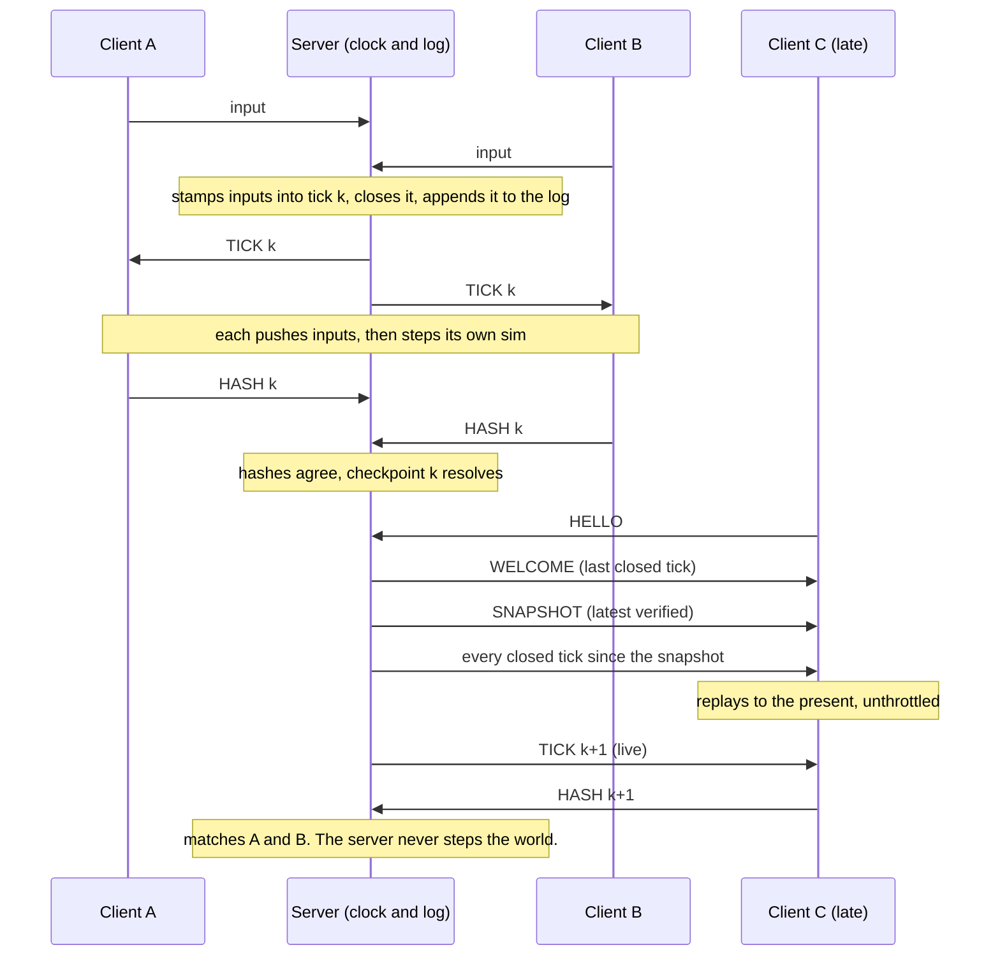
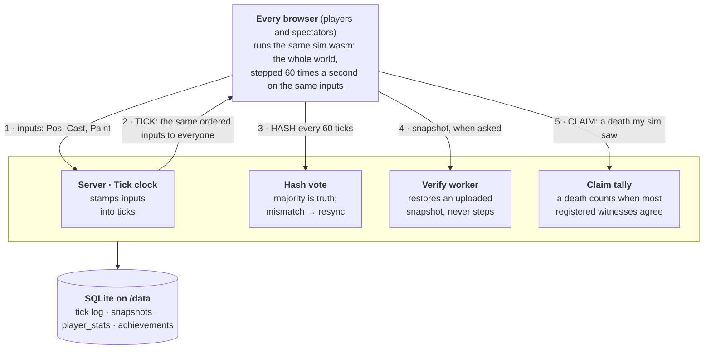
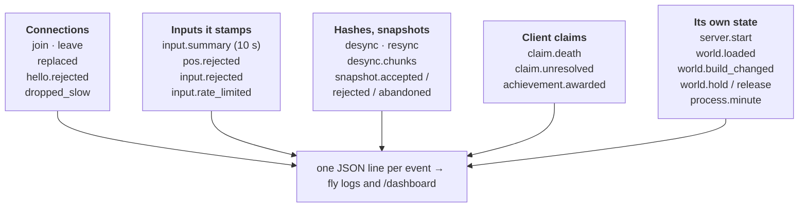
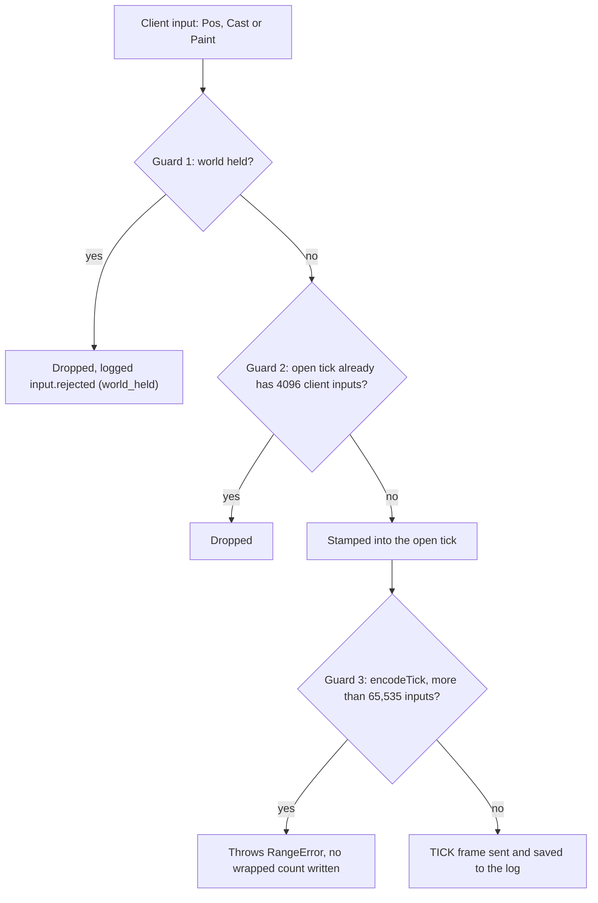
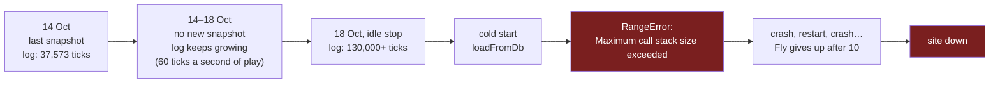
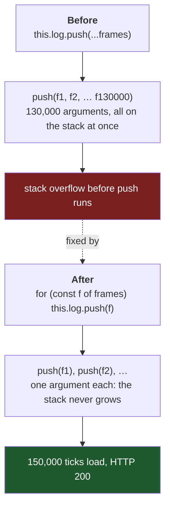
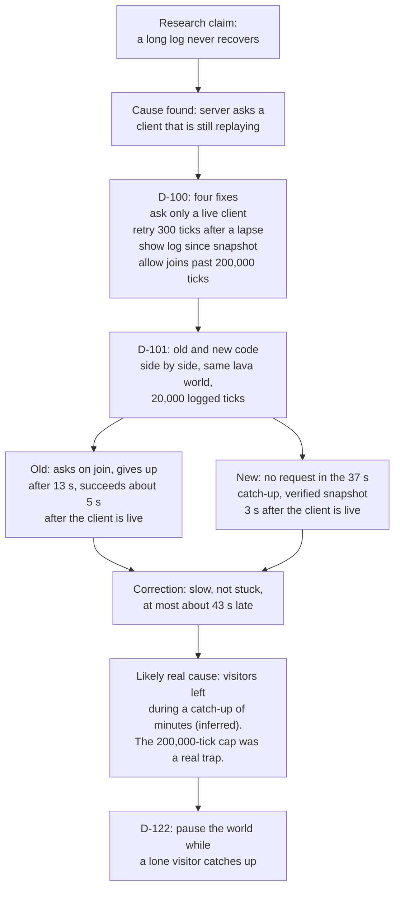
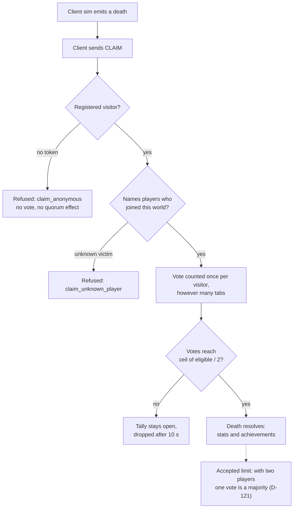
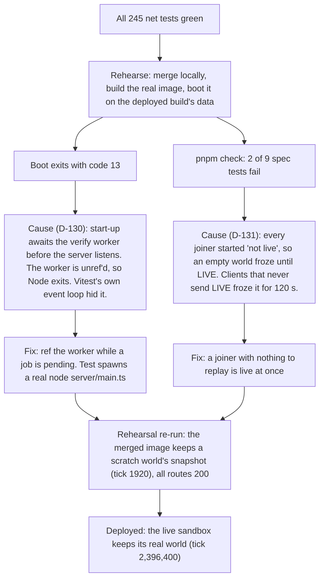

# Engineering decisions and challenges

This is a curated account of the decisions that shaped this project and the
problems that cost the most time, and how each was reasoned about. It is a
reading copy, not the record. [`DECISIONS.md`](DECISIONS.md) is the complete
log (D-001 to D-101, one row per change) and stays the source of truth. Here I
pick about a dozen and tell each as a short story, with links back to the rows,
the research notes in [`research/`](research/) and the commits. Where a belief
turned out wrong, the correction is kept in the text, because that is the part
worth learning from.

Numbers come from the repo and say where. "Measured" means a number in a
research note or a D-row. "Inferred" means nobody checked it directly.
Commit links use the same form as [`PROCESS.md`](../PROCESS.md).

The game is a shared falling-sand world in the browser. The design is in
[`plan.md`](plan.md); a diagram of the networking is in
[`lockstep-networking.png`](lockstep-networking.png).

## Contents

Decisions
1. [Server-paced deterministic lockstep](#1-server-paced-deterministic-lockstep)
2. [A Rust simulation in WebAssembly, with hard rules](#2-a-rust-simulation-in-webassembly-with-hard-rules)
3. [Counter-based randomness](#3-counter-based-randomness)
4. [Every client simulates; the server only checks](#4-every-client-simulates-the-server-only-checks)
5. [The networking: ticks, playout, protocol versions](#5-the-networking-ticks-playout-protocol-versions)
6. [Persistence on a machine that stops when idle](#6-persistence-on-a-machine-that-stops-when-idle)
7. [A determinism harness before any game code](#7-a-determinism-harness-before-any-game-code)
8. [Chunk sleeping that must be invisible](#8-chunk-sleeping-that-must-be-invisible)
9. [Identity and names](#9-identity-and-names)
10. [Observability, the dashboard and admin reset](#10-observability-the-dashboard-and-admin-reset)
11. [A config replaces the world kind, and ends a compatibility guarantee](#11-a-config-replaces-the-world-kind-and-ends-a-compatibility-guarantee)
12. [Rooms land in three slices, the first one inert](#12-rooms-land-in-three-slices-the-first-one-inert)
13. [The menu wires the client into real rooms for the first time](#13-the-menu-wires-the-client-into-real-rooms-for-the-first-time)
14. [Creative, and the server split that would have broken its brush](#14-creative-and-the-server-split-that-would-have-broken-its-brush)

Challenges
15. [The live site went down on 18 October](#15-the-live-site-went-down-on-18-october)
16. [Snapshot timing, and the correction](#16-snapshot-timing-and-the-correction)
17. [The late-join test that failed after the world cache](#17-the-late-join-test-that-failed-after-the-world-cache)
18. [Liquids "stuck in staircases"](#18-liquids-stuck-in-staircases)
19. [Performance gate P1](#19-performance-gate-p1)
20. [What independent reviews caught that tests missed](#20-what-independent-reviews-caught-that-tests-missed)
21. [Snapshot format 3 before any game snapshot exists](#21-snapshot-format-3-before-any-game-snapshot-exists)
22. [A cross-browser check that tested nothing it named](#22-a-cross-browser-check-that-tested-nothing-it-named)
23. [An achievement the sim's outputs cannot express](#23-an-achievement-the-sims-outputs-cannot-express)
24. [The merge rehearsal: two bugs only the real image could show](#24-the-merge-rehearsal-two-bugs-only-the-real-image-could-show)

---

## 1. Server-paced deterministic lockstep

**Context.** Everyone shares one destructible world of sand, water and fire,
live, on one 256 MB shared-CPU Fly machine.

**Decision.** Every browser runs the same simulation on the same ordered stream
of inputs. The server stamps inputs with a tick number, closes ticks on its own
clock and broadcasts them. It never steps the simulation.

**Alternatives considered.** A server-side simulation. Syncing world state
instead of inputs. Peer-to-peer, or rollback netcode.

**Why.** A shared vCPU gets a small baseline share of a core and would be
throttled by a 60 Hz world (plan section 3). A single explosion changes tens of
thousands of cells, which rules out syncing state. Browsers are free compute.
Lockstep is exactly consistent by construction, so a desync is always a bug,
which hashes can detect and the input log can reproduce.

**Cost / consequences.** Determinism is all-or-nothing. That one fact produced
the next four entries: the sim's hard rules, counter-based randomness, the
test harness before any game code, and a server that has to police clients
without being able to run the sim. The out-of-scope list (plan section 16, and
invariant 11 in `CLAUDE.md`) bans server stepping, P2P and rollback so a later
session cannot quietly reopen the choice.

**A late joiner, step by step.** A client joining mid-game gets the latest verified snapshot and every tick closed since, replays them, and must report the same hash as everyone else. The server orders and checks; it never steps the world.

WELCOME carries the last closed tick, which is the joiner's replay target (D-030). A client only sends HASH for ticks past that target (D-038).

**Evidence.** [plan.md section 3](plan.md); D-002, D-003 in
[DECISIONS.md](DECISIONS.md); commit
[`7a99056`](https://github.com/comp4020-agentic-coding-studio/comp4020-final-yarramoo/commit/7a99056)
(the plan);
[`bc033ad`](https://github.com/comp4020-agentic-coding-studio/comp4020-final-yarramoo/commit/bc033ad)
(the plan conformed to the real course setup, such as 256 MB not 512).

## 2. A Rust simulation in WebAssembly, with hard rules

**Context.** Lockstep only works if every browser engine and CPU produces
bit-identical results from the same inputs.

**Decision.** The simulation is Rust compiled to `wasm32`. It follows rules
that are enforced by tools, not by care:

- No floating point, with `#![deny(clippy::float_arithmetic)]`; fixed point
  instead. Floats are the classic source of cross-machine drift.
- No host imports. CI asserts `WebAssembly.Module.imports(module)` is empty, so
  the sim cannot read a clock, a random source or the JS engine.
- No `HashMap` or `HashSet`, banned with clippy `disallowed-types`. Their
  iteration order is not guaranteed.
- Hash only fixed-width integers, never `usize`, which is 32-bit on wasm32 and
  64-bit natively.
- The ABI carries integers only, so aim angles and positions are quantised in
  TypeScript before they become inputs.

**Alternatives considered.** Writing the sim in TypeScript, which would make
float and engine differences much harder to rule out. AssemblyScript or C.

**Why.** Rust and its wasm target were already installed (D-006), and each rule
removes a whole class of "works on my machine" bug. A rule that a linter checks
cannot be forgotten by a worker agent at 2 am.

**Cost / consequences.** Everything is integer arithmetic, including cave
generation (a checked-in smoothstep table, D-051) and aim (a baked trig table,
see the next entry). New input kinds must also bound their cost, because every
client runs every input: an early commit clamped Paint so one huge stroke could
not freeze the room.

**Evidence.** Invariants 1 to 11 in `CLAUDE.md`; [plan.md section 4](plan.md);
D-006, D-017, D-051;
[`92ed2f0`](https://github.com/comp4020-agentic-coding-studio/comp4020-final-yarramoo/commit/92ed2f0)
(sim skeleton),
[`3094d25`](https://github.com/comp4020-agentic-coding-studio/comp4020-final-yarramoo/commit/3094d25)
(Paint clamp),
[`e10ed73`](https://github.com/comp4020-agentic-coding-studio/comp4020-final-yarramoo/commit/e10ed73)
(byte layouts pinned before the Rust and TypeScript workers started).

## 3. Counter-based randomness

**Context.** Cells need random choices (which way water slides, whether fire
spreads), and every client must make the same ones.

**Decision.** `rng(seed, tick, x, y, salt)` is a pure function that mixes its
five inputs. There is no stateful generator. Every distinct use gets its own
salt constant. Aim uses a 1024-entry sine table generated by a script and
checked in (D-075).

**Alternatives considered.** A seeded stateful PRNG advanced in update order.

**Why.** With a stateful generator, any change in the order cells are visited,
or any skipped draw, shifts every later random number and the clients diverge.
A counter-based draw depends only on where and when it is made, so ordering
cannot matter. It also makes snapshots trivial: there is no generator state to
save. The trig table avoids calling `sin`, which uses floats that can differ
by platform. 1024 entries is 2 KB, against 128 KB for a full 16-bit
table, and the aim resolution is about 0.35 degrees (D-075).

**Cost / consequences.** Every random draw costs three mix rounds, and profiling
later found draws that could not matter (entry 19). Long-range spells would
need a finer table.

**Evidence.** [plan.md section 6.3](plan.md); D-051, D-075, D-087;
[`1bc6b0e`](https://github.com/comp4020-agentic-coding-studio/comp4020-final-yarramoo/commit/1bc6b0e)
(projectiles and the baked trig table).

## 4. Every client simulates; the server only checks

**Context.** The server never steps the sim (invariant 11), but a client can
drift, lie or upload a bad snapshot.

**Decision.** The server checks without simulating:

- Clients send a HASH every 60 ticks. The server takes the majority as truth
  and resyncs any client that differs (D-038).
- On a divergence the server asks every reporter for its per-chunk hashes
  (kept for the last 5 checkpoints) and records which chunks differ in the
  incident, so a desync names where, not just who (D-126).
- Snapshots are produced by clients. The server accepts one only when the
  uploader's claim, the majority hash and an independent restore all agree
  (D-040).
- That restore runs in a `worker_threads` worker that decompresses, restores and
  hashes but never steps (D-066).
- Input validation is light: the server re-adds the player id to every input,
  so a client cannot name another player (D-032), and Pos jumps are bounded.

**The simulation model.** The world exists only in the browsers. The server
orders inputs and checks agreement; it never steps the world, so it never sees
a death, a pickup or an explosion. That is why deaths reach it only as client
claims, accepted by majority (D-118, D-119).

What the server can see, and so what it can log, is limited to what crosses
the wire. These are the events in `shared/events.ts`, grouped by what produced
them:

Damage, deaths, pickups and explosions happen inside each browser's sim. The
server learns of a death only when enough witnesses claim it; it never learns of
a pickup or an explosion at all.

**Alternatives considered.** Trusting the first uploader. Restoring on the main
thread. Server-side replay.

**Why.** Restoring regenerates the world, and measured in D-066 a main-thread
restore blocks for about 260 ms against a 16 ms tick clock. In the worker, a
game snapshot verified in 381 ms while the worst gap between closed ticks was
21 ms (measured, D-066).

**Cost / consequences.** A world with one connected client has no majority, so
its hashes become the truth and a drifted lone client could have a bad snapshot
verified. I accepted that gap and logged it (D-045); determinism, tested in
four engines, is what protects state, and the hash check bites once a second
client is present.

**Evidence.** D-038, D-040, D-045, D-066, D-071;
[`fb59b10`](https://github.com/comp4020-agentic-coding-studio/comp4020-final-yarramoo/commit/fb59b10)
(snapshots, hash checks, resync);
[`43a1cab`](https://github.com/comp4020-agentic-coding-studio/comp4020-final-yarramoo/commit/43a1cab)
(off-thread verify);
[`ac44fc3`](https://github.com/comp4020-agentic-coding-studio/comp4020-final-yarramoo/commit/ac44fc3)
(the lone-client gap logged).

## 5. The networking: ticks, playout, protocol versions

**Context.** Browsers at different speeds must apply the same ticks and still
feel responsive.

**Decision.**

- Ticks are numbered from 1. Closed tick k is applied as "push its inputs, then
  step", so `sim.tick() == k` afterwards. WELCOME carries the last closed tick,
  which is the joiner's replay target (D-030).
- The server clock runs only while players are connected. `stamp()` first
  closes every tick that has passed, so a late timer cannot skip a tick or file
  an input into one already gone (D-035).
- The client holds a playout buffer: it holds when empty and rebuffers to two
  ticks. Catch-up runs unthrottled in 12 ms slices per frame, rendering between
  (D-034).
- Protocol bumps: v1 (HELLO, INPUT, TICK), v2 (HASH, snapshots, RESYNC), v3
  (spectator flag, player names), v4 (HASH carries step time and buffer depth).
- Knockback is applied by the victim's own client when its sim reaches the tick.
  The sim records who hit whom; the push itself is capped to the server's Pos
  limit (D-076).

**Alternatives considered.** Making knockback a sim effect on avatar position.
A separate STATS frame instead of widening HASH (D-094).

**Why.** Avatars are not lockstepped (each client predicts its own and sends
Pos), so a victim's position is only known to its own client. Letting that
client apply the push keeps avatar state out of the hash.

**Cost / consequences.** A client that ignores a Knock is simply not pushed, and
nothing validates it; that is acceptable for a co-op game. Bumping the protocol
costs every open tab: after v4, an old tab gets "protocol version mismatch: new
version, reload" and must refresh on every deploy (D-094).

**Evidence.** D-030, D-032, D-034, D-035, D-036, D-064, D-076, D-094;
[`a2d8367`](https://github.com/comp4020-agentic-coding-studio/comp4020-final-yarramoo/commit/a2d8367)
(lockstep server),
[`fcb3b58`](https://github.com/comp4020-agentic-coding-studio/comp4020-final-yarramoo/commit/fcb3b58)
(protocol v4),
[`9520446`](https://github.com/comp4020-agentic-coding-studio/comp4020-final-yarramoo/commit/9520446)
(client casting and knockback).

## 6. Persistence on a machine that stops when idle

**Context.** Fly stops the machine when nobody is connected, so a cold start is
the normal path, not a crash path. A marker's next-day visit always takes it.

**Decision.** SQLite (`node:sqlite`, WAL) on the `/data` volume. The world
stores the latest verified snapshot plus the tick log after it. Start-up is
"restore the snapshot, replay the log", and the first client to join does the
replay, not the server. Migrations are an append-only array under
`PRAGMA user_version`. The server shuts down on SIGTERM by closing the open
tick and flushing the log.

**Alternatives considered.** Fly Postgres, which is outside the course setup
(D-002). Snapshotting the last player out (D-004's original plan).

**Why.** One machine and one volume are all `fly.toml` allows. For the last
player out, D-042 took the plan's own fallback: that client is gone before the
server can ask, and a round trip plus a majority hash would delay the Leave.
Replay is at most one interval, about 30 s of ticks.

**Cost / consequences.** A new sim build cannot replay an old log under new
rules (plan 9.3). On start-up with a changed build, D-041 drops the old log and
keeps the snapshot if the new build can restore it, else resets the world. After
crit 10 a reset is not allowed (D-014), so snapshot compatibility is tested
against bytes the deployed build actually wrote: a committed fixture from the
live sandbox (D-068). The restored world then plays forward under the new
rules, which is why `compat.test.ts` separates a DATA claim (must hold forever)
from a RULES claim (changes on purpose).

**Evidence.** D-002, D-004, D-014, D-039, D-041, D-042, D-044, D-050, D-068,
D-081; [plan.md section 9](plan.md);
[`fb59b10`](https://github.com/comp4020-agentic-coding-studio/comp4020-final-yarramoo/commit/fb59b10)
(snapshots and persistence),
[`b9a03db`](https://github.com/comp4020-agentic-coding-studio/comp4020-final-yarramoo/commit/b9a03db)
(deploy-prep decisions).

## 7. A determinism harness before any game code

**Context.** Because determinism is all-or-nothing, the first milestone had no
gameplay at all.

**Decision.** Build the harness first. A seeded input generator drives the sim
in Node, Chromium, Firefox, WebKit and native Rust, and the hash logs must
agree. The tests are D1 (repeatable), D2 (cross-engine), D3 (native against
wasm), D5 (snapshot round trip), D6 (step batching), D10 (the canary) and D11
(static guards). D10 is a deliberately broken build that imports one host
function returning an engine-dependent value; D2 must fail on it.

**Alternatives considered.** Writing game features first and adding tests later.

**Why.** A test that has never failed proves nothing. The canary shows the
harness can see nondeterminism, and the input script exercises the sim (690
paints, 30 of 30 distinct checkpoint hashes, D-020), so agreement is evidence
rather than an idle world agreeing with itself.

**Cost / consequences.** The suite takes about 50 s, so it is separate from
`pnpm check` (D-019). D4, the cross-architecture run on an ARM device, was owed
and never closed in the record: CI only runs once the repo is public, and a
phone run was left for later (D-020).

**Evidence.** D-015, D-019, D-020, [plan.md section 12](plan.md);
[`4f8cca6`](https://github.com/comp4020-agentic-coding-studio/comp4020-final-yarramoo/commit/4f8cca6),
[`81b8431`](https://github.com/comp4020-agentic-coding-studio/comp4020-final-yarramoo/commit/81b8431),
[`d911c8f`](https://github.com/comp4020-agentic-coding-studio/comp4020-final-yarramoo/commit/d911c8f).

## 8. Chunk sleeping that must be invisible

**Context.** The world is 512 by 512 in the sandbox and larger in the game, and
most of it is at rest.

**Decision.** Each 64-cell chunk has an `awake` flag. A touched cell wakes its
chunk and any neighbour within one cell of the shared edge. The flag clears
before a chunk runs and is set again by a touch or by a volatile cell (fire,
smoke, steam, seeds, lava, growing stems, primed gunpowder). The flag is scratch
state, not hashed and not snapshotted. Invariant 8 says sleeping must be
semantically invisible, and test D7 proves it by hashing runs with sleeping on
and off.

**Alternatives considered.** Running every chunk every tick, which is the
worst-case baseline (D-053).

**Why.** Sleeping is an optimisation, so it must not change results. If it did,
a client that woke a chunk at a different time would desync.

**Cost / consequences.** The first rule missed a case, which D5 (the snapshot
round trip) caught by failing: a cell already moved by a neighbour this tick can
change without a touch in its own chunk's run. Skipped-because-moved cells are
now volatile too (D-054). In the generated world, 80 of 768
chunks run at rest (D-057, measured).

**Evidence.** D-053, D-054, D-057;
[`3f68c14`](https://github.com/comp4020-agentic-coding-studio/comp4020-final-yarramoo/commit/3f68c14),
[`a104231`](https://github.com/comp4020-agentic-coding-studio/comp4020-final-yarramoo/commit/a104231),
[`ab07e1a`](https://github.com/comp4020-agentic-coding-studio/comp4020-final-yarramoo/commit/ab07e1a).

## 9. Identity and names

**Context.** A player needs to come back as the same character, with their
inventory, and the crit needs readable logs.

**Decision.** `POST /api/players` returns a random 32-byte token and stores only
its SHA-256. A known token maps to a database row whose id is the sim player id.
A second connection with the same token replaces the first (close code 4000), so
a reload recovers at once. Names are plain text, cleaned of control and bidi
characters. Players only ever see the plain name; `name#id` exists in logs and
database keys. Later, every visitor gets a name, and a sandbox painter or
spectator with no token is accepted as anonymous (D-090).

**Alternatives considered.** Rejecting a second connection. Using the
registered id as the sandbox sim id, which would change the saved world.
Refusing anonymous painters, which would break old tabs.

**Why.** A stored hash means a database leak does not leak sessions. The id is
the sim id so the entity returns without a lookup table.

**Cost / consequences.** Anti-teleport was harder than it looked, see entry 20
for the exploit. A zero token once minted a permanent player on every connect,
so an unclaimable token no longer gets a player (D-069).

**Evidence.** D-065, D-069, D-070, D-078, D-079, D-090;
[`43a1cab`](https://github.com/comp4020-agentic-coding-studio/comp4020-final-yarramoo/commit/43a1cab),
[`f3bf030`](https://github.com/comp4020-agentic-coding-studio/comp4020-final-yarramoo/commit/f3bf030),
[`2e9bdbf`](https://github.com/comp4020-agentic-coding-studio/comp4020-final-yarramoo/commit/2e9bdbf).

## 10. Observability, the dashboard and admin reset

**Context.** Crit 10 has classmates use the URL while I read the logs, so the
logs had to exist before it, not at the end (D-010).

**Decision.** Every server action is a structured JSON event from a fixed
catalogue; rate-limited where a client can repeat it. A per-connection
`input.summary` every 10 s replaced per-cast lines, which a held mouse would
have turned into 6 lines a second (D-092). RTT is timed by the server from a
WebSocket ping (D-093). The dashboard has a public view (aggregates only, no
names) and an admin view behind `ADMIN_TOKEN`. An admin can reset a world.

**Alternatives considered.** Polling or WebSocket for the dashboard (SSE chosen,
D-096). Timing the app-level ping.

**Why.** An admin reset does not contradict D-014. D-014 forbids an accidental
reset by a deploy that changes a format. D-097 is a deliberate wipe, for when
classmates have wrecked a world. The reset updates the database first, so a
failure rolls back and leaves memory untouched; and a generation counter makes a
verification already running in the worker drop its result rather than save a
pre-reset snapshot.

**Cost / consequences.** D-098 puts `ADMIN_TOKEN` in `fly.toml` in a public repo
because the user could not set a secret before crit 10. Anyone who reads the
repo can open the admin view and reset a world. The decision record says so
plainly and says to move it to a secret if the world starts to matter.

**The input-count bug the hold created.** While the clock was held for a catching-up visitor (D-122), client inputs piled into one open tick. A TICK frame stores its input count as a 16-bit unsigned integer, so past 65,535 the count would wrap while every input was still written: every client would misread the frame, and it is saved to the log. Three guards now stop it (review of D-122).

Guards 1 and 2 are in `World.stampClient`. Join and Leave are the server's own and bypass the cap, which is why the encoder keeps its own hard check.

**Evidence.** D-010, D-092 to D-098; [review-crit10.md](research/review-crit10.md),
[review-crit10-reset.md](research/review-crit10-reset.md);
[`9eecdab`](https://github.com/comp4020-agentic-coding-studio/comp4020-final-yarramoo/commit/9eecdab),
[`d088c4f`](https://github.com/comp4020-agentic-coding-studio/comp4020-final-yarramoo/commit/d088c4f),
[`0ca9f5e`](https://github.com/comp4020-agentic-coding-studio/comp4020-final-yarramoo/commit/0ca9f5e).

## 11. A config replaces the world kind, and ends a compatibility guarantee

**Context.** PvP consent was broken: one fighter in the shared game world forced everyone else to fight, because
the only way to tell worlds apart was a bare `world_kind` byte (0 sandbox, 1 game) compiled into every rule gate.
Rooms need their own terrain, damage, spells and player cap, and the plan reserved D-132/D-133 for exactly this
before any code existed.

**Decision.** A 16-byte, versioned `RoomConfig` (terrain, size, avatars, damage, spells, brushes, death,
respawn_secs, pickup_respawn, round, max_players, 4 reserved bytes, all zero-checked) replaces `world_kind` at the
ABI (`init(seed_lo, seed_hi, cfg_ptr, cfg_len)`) and in every sim rule gate, which now reads a helper
(`has_players()`, `paint_allowed()`, ...) instead of a bare compare. Worlds 0 and 1 become presets
(`classic_sandbox()`, `caves_pvp()`) built to reproduce today's state hashes exactly. The config bytes are
themselves hashed, so two clients running different configs diverge at tick 0 instead of silently agreeing.
Snapshot format bumps to 4, with the config in the header; restore refuses every older format. `shared/room.ts`
mirrors the Rust layout field-for-field, and the round-trip and refusal tests in both languages share the literal
same hex vectors, not independently-authored ones that happen to agree. The protocol itself is untouched: server
and client map world kind 0/1 to a preset locally (D-132, D-133).

**Alternatives considered.** Keeping `world_kind` and adding a second dimension alongside it (more gates to keep in
sync, not fewer). Versioning the config as forward-compatible, accepting unknown future fields (rejected: a version
byte that must match exactly is simpler and the game is not live, so there is no old client to be lenient to).

**Why.** Rooms (R2) need per-room rules, which a compile-time `world_kind` cannot express. Reproducing today's
presets byte-for-byte meant R0a could land with the determinism suite's existing hashes as its own regression test,
rather than writing new fixtures to trust.

**Cost / consequences.** Format 4 refuses every snapshot from versions 1-3, which ends the deployed-sandbox
compatibility guarantee from D-014 and D-068 — acceptable only because the 21 Oct redirect says the game is not
live and world resets are fine until the user says otherwise. If the sandbox is declared live before R2 ships a
protocol-level config, this needs a migration path first. Separately, `RoomConfig.max_players` is decoded, hashed
and range-checked (2..=8) but not yet enforced against the live player count: only the pre-existing global
`MAX_PLAYERS = 1024` gates joins. This was flagged independently by the worker and by a cold second review
(entry 20), and is deferred, not forgotten (D-138) — it's strictly more permissive than before, not a new hole, but
R2/R6 (Survival's lobby cap) must not assume it already works.

**R1: every (terrain, size) combination, not just the two presets.** A config's `terrain` and `size` fields were
only real choices once every combination they could name actually produced a world. R1 generalised gen v2 (its
traversal fix, D-083/`ec188a0`, had only ever run at Caves' one size, L) to Caves at S and M too, built Solid box
(Dirt over Rock, a static layered fill, no cave algorithm) at every size, and opened Empty box (today's sandbox
fill) up from size S only to every size. The traversal test (`traversable_to_every_band`) now loops all three
sizes, each against its own target depth, rather than asserting only L reaches the deep band.

Every absolute row/column constant the generator had baked in for L's 2048x1536 (band boundaries, repair depth,
link-worm rows, material pile counts and spans) is now derived once per `generate` call by a `Scale` struct:
depth/row quantities scale linearly by usable height (`h - FLOOR_ROWS`, exact at L by construction, so the
`caves_pvp` preset's generation path is unchanged bit-for-bit), and counts (piles, trees, pickup spots) scale by
area relative to L's, with hand-picked floors so a small world still gets a sensible minimum. This was checked
independently, not just taken from the worker's report: the session model computed `classic_sandbox` (seed 42) and
`caves_pvp` (seed 5) state hashes at ticks 0/40/80/120 in a separate git worktree at the pre-R1 commit and again at
R1's head, and they match exactly.

**Alternatives considered.** Scaling by raw height instead of usable height (simpler, but a bigger relative error
at S, where the 64-row floor band is 12.5% of the world's 512). Scaling width-dependent spans by the same area
ratio as counts (rejected for now as the less reversible choice — it would also need re-deriving every margin
constant per size; keeping L's absolute wall margin was lower-risk without a preview to judge the alternative by
eye, logged in FUTURE.md for a later look).

**Why.** Rooms (R2) need Caves, Solid box and Empty box to actually be available at every size a room can request,
not just the two combinations that happened to exist before R0a. Reproducing `caves_pvp`'s hash exactly, the same
discipline R0a held to, meant R1 could also land with the existing determinism suite as its own regression test.

**Cost / consequences.** Gen time doesn't scale down with world size the way cell count would suggest: S (512x512)
measured 85 ms native, M (1024x768) 91.5 ms, L (2048x1536) 245.6 ms — S is barely cheaper than M despite a quarter
of the area, because count floors and fixed-cost passes (noise setup, the repair-traversal flood) don't shrink
with the grid in this range. Logged in FUTURE.md: this matters for R2's room-creation latency budget. The
`scale_count` floor values and Solid box's dirt-depth formula are tuned by eye, not measurement; cosmetic only
(the traversal guarantee doesn't depend on them), left for a look at the now-multi-size `gen-preview.html`.

**Evidence.** D-132, D-133, D-137, D-138, D-139; [plan-game-modes.md](plan-game-modes.md) "Config fields",
"Caves: gen v2 everywhere"; [review-r0a.md](research/review-r0a.md), [r1-worker-report.md](research/r1-worker-report.md);
[`8ee79f3`](https://github.com/comp4020-agentic-coding-studio/comp4020-final-yarramoo/commit/8ee79f3)
(config.rs and shared/room.ts),
[`425cab4`](https://github.com/comp4020-agentic-coding-studio/comp4020-final-yarramoo/commit/425cab4)
(snapshot format 4),
[`1964349`](https://github.com/comp4020-agentic-coding-studio/comp4020-final-yarramoo/commit/1964349)
(Caves at every size, the scaled generator).

## 12. Rooms land in three slices, the first one inert

**Context.** R2 ("rooms on the server") replaces the two fixed worlds with a room table, a creation/listing API,
a protocol bump, a lazy load/unload lifecycle and admission caps. It is the plan's largest milestone, and it
touches the two files every other live feature depends on: `server/world.ts` (1311 lines, the tick clock, the
hash/snapshot checks, every socket-facing rule) and `server/main.ts` (1006 lines, HELLO/WELCOME, every existing
route). CLAUDE.md warns specifically against fanning out agents on a coupled, multi-user surface like this one,
and the plan's own review column already marks R2 as needing an independent reviewer for its protocol and
lifecycle work.

**Decision.** Split R2 into three sequential slices instead of one dispatch: **R2a** (this entry) builds the
`rooms` table and `POST/GET /api/rooms`/`GET /api/rooms/:code`, but deliberately touches nothing on the socket
path — a room can be created and listed, but nothing can join one, so the two fixed worlds (`/`, `/sandbox`)
keep working exactly as before. **R2b** (not yet built) wires rooms into HELLO/WELCOME (protocol v9), adds the
lazy load/unload lifecycle and the capacity note's admission caps, and gets the independent reviewer R0a and
the plan both call for. **R2c** re-measures capacity (`pnpm soak:capacity`) against the room-ified server.

**Alternatives considered.** One large worker building all of R2 at once (rejected: too much surface for one
review pass, and a bug in the lifecycle code would be indistinguishable from a bug in the data layer when
something broke). Building the protocol change first (rejected: the data model and validation are independently
useful to prove correct, and R2a's tests can run against the real Docker image without needing a single live
socket change to risk).

**Why.** An inert first slice cannot regress a live, working feature: the worst a bug in R2a can do is make
`/api/rooms` misbehave, since nothing reads from the `rooms` table outside it yet. Reviewing R2a therefore didn't
need the independent-reviewer pass the plan reserves for R2 as a whole — the session model reviewed it directly
the same way R1's terrain work was reviewed, and verified the claims by hand: built and booted the real Docker
image, and curled every new route (a valid create, a bad-config rejection, a cross-origin refusal, an unlisted
room correctly hidden from the public list but still fetchable by its code, case-insensitive code lookup)
against the live container, rather than only reading the worker's report of having done the same.

**Cost / consequences.** Anonymous room creation (`POST /api/rooms` has no authenticated identity on this HTTP
path yet) has no rate limit at all — confirmed by hand, four consecutive anonymous creates from one address all
returned 201. This is an open flood vector until R2b wires identity onto the path and adds IP-based limiting
(D-141, logged in `FUTURE.md`); acceptable only because the game is not live. The public room list sorts by
`last_active` only, with a `TODO(R2b)` for a live player count, since no room is joinable yet to have one. Two
existing tests' hardcoded `schemaVersion` assertions needed a one-line bump (5 to 6) for the new migration,
a mechanical cost every future migration will repeat unless a later slice makes the assertion self-deriving.

**R2b: rooms become joinable, and the independent review earns its place.** Protocol v9 lets WELCOME carry a
room's actual 16-byte config instead of a bare world-kind byte, so a joiner inits from the exact bytes every
other member of the room shares; `getOrLoadRoom` loads a room's `World` on first HELLO for it, keyed by an
in-flight-promise map so two near-simultaneous HELLOs for the same unloaded room id converge on one load rather
than racing to construct two. A room unloads on a uniform 2-minute empty timer (mode-specific archive/delete
timing stays deferred). Admission caps from `capacity-rooms.md` (32/48 members, 16 loaded-room slots, an L room
weighted 2) are checked before a room is constructed, reading cgroup memory per that note's own finding that RSS
overstates it. In passing, R2b also fixed a real bug the brief had to name explicitly: `World.acceptPos` bounded
every Pos against the fixed L-sized `GAME_W`/`GAME_H`, silently wrong for any S or M room now that R1 made those
sizes real.

The independent reviewer this slice was built to get (D-140's rationale) found two HIGH-severity bugs neither the
worker nor the session model's own reading had caught: a join rejected by the member cap, and separately a
bad-token HELLO that fired after the unload timer had already been canceled, both left a freshly-loaded,
zero-member room pinned in memory permanently — exactly the resource the new admission caps exist to protect,
and exactly the question the reviewer's brief asked ("are caps checked before a `World` is constructed, so a
rejected join doesn't still pay the cost") turning out to be only half-true. The session model reproduced both
with a standalone script against the real server code before accepting either finding, and again after the fix,
rather than trusting either report. D-143 has the full account.

**R2c closes the question this milestone asked.** The plan's own acceptance line for R2 ("24 sockets over 4
rooms, a forced verify; pass is under 200 MB") is a real number, not a code review, so it needed a bench over
real rooms rather than the pre-R2 two-fixed-world one. 4 runs passed (171.82, 95.74, 103.90, 104.86 MB cgroup),
but not evenly: one run used 86% of the budget while the other three used about half that, on an identical
scenario run seconds apart. The report names this plainly rather than rounding it into "comfortably under 200
MB" — the pre-R2 table's own "first activity" jump is the likely cause (now paid once per freshly-loaded room
instead of once for two always-loaded worlds), but that split was left unmeasured rather than guessed at. The
session model re-ran the bench twice more independently before accepting the numbers (106.7, 103.85 MB, both in
the "normal" cluster) and confirmed the Docker container is cleaned up on every exit path, including the error
path.

**Evidence.** D-140, D-141, D-142, D-143, D-144; [plan-game-modes.md](plan-game-modes.md) "Server: rooms instead
of two fixed worlds"; [capacity-rooms.md](research/capacity-rooms.md);
[r2a-worker-report.md](research/r2a-worker-report.md), [r2b-worker-report.md](research/r2b-worker-report.md),
[review-r2b.md](research/review-r2b.md), [r2b-fix-report.md](research/r2b-fix-report.md),
[r2c-worker-report.md](research/r2c-worker-report.md);
[`120075b`](https://github.com/comp4020-agentic-coding-studio/comp4020-final-yarramoo/commit/120075b)
(the rooms table and `RoomsStore`),
[`8be0076`](https://github.com/comp4020-agentic-coding-studio/comp4020-final-yarramoo/commit/8be0076)
(the HTTP API),
[`064613c`](https://github.com/comp4020-agentic-coding-studio/comp4020-final-yarramoo/commit/064613c)
(protocol v9 and the `acceptPos` fix),
[`b254084`](https://github.com/comp4020-agentic-coding-studio/comp4020-final-yarramoo/commit/b254084)
(the member-cap leak fix),
[`8c11131`](https://github.com/comp4020-agentic-coding-studio/comp4020-final-yarramoo/commit/8c11131)
(the cancel-unload-ordering fix),
[`fa1f09a`](https://github.com/comp4020-agentic-coding-studio/comp4020-final-yarramoo/commit/fa1f09a)
(the real-room capacity bench).

## 13. The menu wires the client into real rooms for the first time

**Context.** R2 built rooms end to end on the server — a table, an API, a lazy load/unload lifecycle, admission
caps — but nothing in `client/` could reach any of it. The client still only ever joined the two fixed worlds by
URL path (`/sandbox` → id 0, everything else → id 1), and `client/worker.ts` still initialised the sim from a
bare "kind" number, which only ever meant something for those two presets.

**Decision.** `/` becomes the menu (mode cards, a polled public room list, a create sheet, a name sheet shown
only at the moment of first Join/Create, a first-visit hint per room) in `client/menu.ts`; the old sandbox/game
page logic moves into `client/room.ts`, generalised to take a `RoomTarget {worldId, cfg, name, code}` resolved
from the URL (`/sandbox`, `/game`, or `/r/<code>` fetched from `GET /api/rooms/:code`) instead of deriving
everything once from a literal path check. The real fix this required: `client/worker.ts`'s `beginReplay` now
initialises the sim from WELCOME's actual 16-byte config (`m.cfg`), not the derived bare kind, at both the
initial join and every resync — a real room's config never matches either fixed preset, so the bare-kind path
would have handed a joined room's sim the wrong rules entirely. Every avatar/cast/steer/follow/spectate check
that used to compare `worldId === 1` now reads `cfg.avatars === 1`, since a real room's numeric id is never 1;
the old Game/Sandbox nav links are deleted outright (the plan says they go away) and replaced with a single
"← Menu" link. The old fixed cave-world page moved from `/` to a direct `/game` route, not a redirect.

**Alternatives considered.** Redirecting `/` to `/game` instead of giving the old world its own route (rejected
as less reversible: a redirect could be layered on top of a direct route later with no further client change,
but unwinding a redirect-based design to get a clean menu landing would repeat work this slice already did).
Inventing a `mode` string for the room page's hint lookup (rejected: the room page never receives the server's
`mode` field, only config bytes, so the hint is keyed on `terrain`/`avatars`/`brushes` instead — a defensible,
if slightly coarser, proxy).

**Why.** The menu is the front door every marker and classmate actually lands on; until it can create and join a
real room, R2's work has no visible effect for anyone who isn't reading the API directly. Deferring commit 6
(the live preview) rather than rushing it matches the brief's own conditional wording: it needs a live
player-count the room list doesn't return yet (an explicit R2a/R2b gap), so building it now would mean guessing
at a number the room list will properly have once that gap closes.

**Cost / consequences.** A Docker boot (not the test suite) caught a real bug before this shipped: `/game` 404'd
on the server's static-file route, because the route only special-cased `/`, `/sandbox` and `/r/<code>`, and no
net or spec test ever visits a page by URL — every existing test joins by raw socket with a numeric world id.
Fixed in the same slice (`3c9d465`). This is exactly the kind of gap CLAUDE.md's "open it and look" and "treat a
red check as authoritative" sections exist for: the full suite was green the whole time this bug was live.

**Evidence.** D-145; [plan-game-modes.md](plan-game-modes.md) "The main menu (the landing page)";
[r3-worker-report.md](research/r3-worker-report.md);
[`2ac3023`](https://github.com/comp4020-agentic-coding-studio/comp4020-final-yarramoo/commit/2ac3023)
(routing, menu shell, the real-config `beginReplay` fix),
[`3c9d465`](https://github.com/comp4020-agentic-coding-studio/comp4020-final-yarramoo/commit/3c9d465)
(the `/game` route fix found by the Docker boot).

## 14. Creative, and the server split that would have broken its brush

**Context.** Creative is the first room with both `avatars: 1` and `brushes: 1` — every earlier room had one or
the other, never both. The sim side of that was straightforward: `cfg.paint_allowed()` (R0a) already checks
`brushes` independently of `avatars`, so nothing in `sim/` needed to change to let an avatar-capable room also
paint. The rest of R4 followed the same shape as every config-driven milestone since R0a: a fill-empty Paint
flag (one bit reused in the existing frame, not a protocol bump), two already-defined but inert config helpers
(`cfg.all_spells()`, `cfg.damage_from_players()`/`damage_from_env()`) finally wired into real sim rules, and a
new preset.

**What the worker found, and correctly didn't fix.** Booting the real server and joining a real Creative room
(the brief's own commit 7) found that every Paint input was rejected, server-side, before the sim ever saw it.
`server/main.ts`'s input dispatch — written in R2b, before a room's config could set `avatars` and `brushes`
independently — treated `World.kind === WORLD_GAME` and "accepts Paint" as mutually exclusive: a game-world
connection could only send Pos or Cast, a sandbox connection only Paint. Every sim-level test for the fill-empty
flag, unlimited spells and damage-off passed, because none of them went through the real socket dispatch — the
gap was invisible to everything this slice's own brief asked it to test. The worker diagnosed the exact cause
and the exact fix, but correctly left it alone: `server/*` was outside this brief's file list, and brief
discipline cuts both ways — a worker that oversteps its scope to "just fix it" is the same failure mode as one
that silently papers over a gap.

**The fix.** The session model reproduced the rejection directly (a standalone script joining a real Creative
room, confirmed rejected), wrote a red-then-green regression test, then made the dispatch's game-world branch
accept Paint when `w.cfg.brushes === 1`, falling through to the same `stampClient` path every other input kind
already uses — a few-line change, not a redesign, exactly as diagnosed. Re-verified end to end against a fresh
Docker container: the room's own session summary logged `"paints":"sand:1","rejected":0`. In the same pass,
fixed `client/menu.ts`'s Creative mode card, which had a hand-duplicated `avatars: 0` config predating the real
`CREATIVE` preset — the menu's own Creative button would have created an avatar-less room with no brush/spell
toggle, now imports `CREATIVE` from `shared/room.ts` directly so the two can never drift apart again.

**Why this is worth recording.** This is the same lesson as R3's `/game` 404 (entry 13) and the M3/M4b findings
in entry 20, told from the opposite direction: there, an independent reviewer or a Docker boot caught a bug
*despite* a green suite. Here, a worker's own Docker boot caught it, correctly scoped the fix as out of bounds,
and reported it clearly enough that closing the gap took minutes, not a re-investigation. A brief's file-list
boundary is there so one slice's worker doesn't accidentally destabilise a file another slice owns — it is not
a reason to ship a feature whose headline mechanic doesn't work over the wire. The fix belongs to whoever is
reviewing the slice, immediately, not to a future "fix the Paint bug" brief.

**Evidence.** D-146, D-147; [plan-game-modes.md](plan-game-modes.md) "Sandspiel-style brushes (Creative)";
[r4-worker-report.md](research/r4-worker-report.md);
[`6ae0b66`](https://github.com/comp4020-agentic-coding-studio/comp4020-final-yarramoo/commit/6ae0b66)
(spells and damage wired to config, the `respawn_secs` bug fix),
[`8d473dd`](https://github.com/comp4020-agentic-coding-studio/comp4020-final-yarramoo/commit/8d473dd)
(the server dispatch fix and the menu.ts correction).

---

## 15. The live site went down on 18 October

**What happened.** The sandbox stopped serving. Every cold start threw
`RangeError: Maximum call stack size exceeded` in `loadFromDb`, and Fly gave up
after 10 restarts.

**What we believed.** That a restart would restore the world, as it does on every
idle stop. The record does not say what was believed before the crash.

**What we found.** Start-up added the replayed log with `push(...frames)`.
Spreading 130,000 or more frames as call arguments overflows V8's stack, and the
sandbox's log since its last snapshot had grown past that. I reproduced it in
the real Docker image on a seeded 150,000-tick log: unfixed, a RangeError and no
HTTP; fixed, 150,000 ticks loaded and HTTP 200 (D-099).

**How it broke.** A cold start restores the last snapshot, then replays every
tick logged since. The log should stay short, because each new snapshot lets the
server drop the log before it. Snapshots had stopped for days (entry 16), so the
log kept growing until one ordinary restart crossed a line nobody knew was there:

The bug is in one line. `push(...frames)` spreads the whole array into separate
call arguments, and every argument takes a slot on the call stack. A few hundred
is nothing; past about 130,000 (measured on Node 24 here; the exact limit
depends on stack size, so it is not a constant) the stack runs out before
`push` even starts:

The fix was proven before it shipped. A database was seeded with 150,000 empty
ticks, and both builds of the real Docker image were booted on it. The unfixed
image threw the RangeError and served nothing; the fixed one loaded all 150,000
ticks and returned HTTP 200. A regression test writes the same long log and
cold-starts, and fails with the same RangeError without the fix.

**What changed.** The log is appended one frame at a time. The fix went onto
`main` first and then `multa`. Why the log had grown so long was not answered
by D-099; entry 16 is that investigation.

**Evidence.** D-099;
[`2c70ceb`](https://github.com/comp4020-agentic-coding-studio/comp4020-final-yarramoo/commit/2c70ceb)
(hotfix on `main`),
[`10247e2`](https://github.com/comp4020-agentic-coding-studio/comp4020-final-yarramoo/commit/10247e2).

## 16. Snapshot timing, and the correction

**What happened.** A log that should be short, because verified snapshots
normally truncate it, had grown past 130,000 ticks. Research
([snapshot-timing.md](research/snapshot-timing.md)) read the code and found the
server asked the longest-connected client for a snapshot even while it was still
replaying; the client could not answer in time, and the request was wasted. A
lapsed request also did not retry for a full cycle.

**What we believed.** That a long log could never recover: "never recovers" was
the note's own heading. Four fixes followed (D-100): ask only a live member,
retry 300 ticks after a lapse, show log length on the dashboard, and stop
refusing joins on a full log.

**What we found.** A side-by-side browser test on the same seeded sandbox (a lava
heap and 20,000 logged ticks), old code `c895a35` against new `70355c5`, showed
the old code was slow, not stuck. It recovered about 5 s after the client went
live, at most about 43 s late. D-101 corrected the account. The likely cause of
the 14 to 18 October gap is visitors leaving during a catch-up that ran for
minutes; that is inferred, because visit lengths were not logged then.

**What changed.** The 200,000-tick cap was a real trap: above it every join was
refused, so no snapshot was possible at all. That fix stands. The note, the
D-row and this entry all keep the correction visible. Of the two real cures,
pausing the clock while every member is still catching up is now built (D-122,
protocol v7 `C_LIVE`): the log stops growing under a lone joiner, and a
snapshot follows soon after they go live. Snapshotting mid-replay is still in
[FUTURE.md](../FUTURE.md) and not built.

**The correction, as a diagram.**

The visitors-leaving explanation is inferred, because visit lengths were not logged at the time.

**Evidence.** D-100, D-101, D-122; [snapshot-timing.md](research/snapshot-timing.md);
[`c895a35`](https://github.com/comp4020-agentic-coding-studio/comp4020-final-yarramoo/commit/c895a35),
[`dbe8495`](https://github.com/comp4020-agentic-coding-studio/comp4020-final-yarramoo/commit/dbe8495),
[`70355c5`](https://github.com/comp4020-agentic-coding-studio/comp4020-final-yarramoo/commit/70355c5),
[`943cefc`](https://github.com/comp4020-agentic-coding-studio/comp4020-final-yarramoo/commit/943cefc).

## 17. The late-join test that failed after the world cache

**What happened.** After caching the generated world so a join did not generate
twice (D-088, joins went from 1170 ms to 320 to 520 ms, measured in Node wasm),
the M4b late-join net test failed. The cache stayed unpushed until it was
explained.

**What we believed.** That the cache altered restored entities, so snapshots
with bolts in flight failed verification.

**What we found.** That was false. The instrumented run showed one snapshot
accepted and none rejected. A bolt exists for only 8 ticks of each 24-tick cast
cycle, and every snapshot tick was a multiple of 120, so every snapshot landed
on the same bolt-free phase. Rejoining re-fetched the same snapshot. Why the test
had passed two runs in three before is not established.

**What changed.** The test only: shooter period 117 ms so the phase walks, a
60-tick cadence, and a rejoin on each new verified snapshot (D-089).

**Evidence.** D-088, D-089; [d088-late-join.md](research/d088-late-join.md);
[`4ad1435`](https://github.com/comp4020-agentic-coding-studio/comp4020-final-yarramoo/commit/4ad1435),
[`5e417ed`](https://github.com/comp4020-agentic-coding-studio/comp4020-final-yarramoo/commit/5e417ed).

## 18. Liquids "stuck in staircases"

**What happened.** From play, a lava heap looked like a staircase on chunk edges,
48 rows high after 100 s.

**What we believed.** That liquids were stuck, and a sleeping bug was ruled out
(sleeping on and off gave identical results). D-081 made liquids slide sideways
to a reach. Its test called `Grid::step_cells` directly in a smaller world.

**What we found.** The browser still showed steps. Comparing against the deployed
build showed it also levelled a large heap, just slowly: flat by about tick
30,000 (8 minutes). The first test had read slow settling as stuck (D-082).

**What changed.** The real problem was settling speed. Dispersion levels the same
heap by tick 16,000 (4.4 minutes), about twice as fast, and the regression test
now measures that on the real sandbox through `Sim::step`. A big lava heap still
takes minutes, partly by design. The lesson: check a diagnosis against the artifact
the user sees.

**Evidence.** D-081, D-082;
[`f48a500`](https://github.com/comp4020-agentic-coding-studio/comp4020-final-yarramoo/commit/f48a500),
[`42e167a`](https://github.com/comp4020-agentic-coding-studio/comp4020-final-yarramoo/commit/42e167a).

## 19. Performance gate P1

**What happened.** The plan set a worst-case budget: step time p95 of at most
8 ms with four players each lighting a fire and a flood. The G2 run found N1,
the live multi-client soak, passing and P1 failing.

**What we believed.** Measured, native p95 was 9.0 ms and 36.0 ms at 4x CPU
throttle ([g2-results.md](research/g2-results.md)). The first reading blamed
chunks that cannot sleep, with the flood the cause, and pointed at tuning sleep
or moving liquids every other tick.

**What we found.** Profiling a native benchmark showed the cell pass was over 95%
of the step, and `liquid_move` drew its left/right rng for nearly every cell of a
settled flood, where the draw cannot matter. D-087 draws only when both sides are
open. Every state hash is unchanged, and p95 fell from 9.0 to 4.8 ms native and
36 to 16 ms at 4x (measured, D-087).

**What changed.** The profile was an honest improvement, but the 4x number is
still over budget. The remaining option, liquids moving every other tick, would
slow water for everyone, so it is a gameplay decision left to the user. Two
limits are on record: the flood was painted with Paint, far more water than a
spell can make, and a real phone was never measured.

**Evidence.** D-080, D-087; [g2-results.md](research/g2-results.md);
[`3111461`](https://github.com/comp4020-agentic-coding-studio/comp4020-final-yarramoo/commit/3111461),
[`3c5188a`](https://github.com/comp4020-agentic-coding-studio/comp4020-final-yarramoo/commit/3c5188a).

## 20. What independent reviews caught that tests missed

**What happened.** Slices that set structure were read cold by a fresh reviewer.
Three findings show why.

**What we found.**

- **M3 S3, a snapshot buffer overrun.** `snapshot::size` ignored entity bytes,
  so once entities existed, `snapshot_write` would overrun a buffer sized from
  it, memory corruption in wasm. Every test passed because the sandbox had no
  entities. Fixed with a size-equals-length test
  ([review-m3.md](research/review-m3.md), D-061).
- **M4b S1, a two-message teleport.** D-073 skipped the distance check on a
  claimed `life + 1` and then adopted the claimed position as the baseline. A
  second Pos with the real life passed against the moved baseline. D-078 keeps one
  baseline per player and life, and a Pos never moves another life's baseline.
  D-079 then widened the respawn window to three lives, because the first fix
  locked out a player who died twice between Pos messages
  ([review-m4b.md](research/review-m4b.md)).
- **Crit 10 S1, an image that would not boot.** `shared/stats.ts` imported client
  source that the runtime Docker stage does not copy. Tests run from the working
  tree and could not see it. Names moved into `shared/`, and a test now checks
  that `server/` and `shared/` never import from `client/`
  ([review-crit10.md](research/review-crit10.md)).

**What changed.** Each review's findings were checked against the code before
being acted on, and the common cause is that tests run in a different place
from where the system ships.

**Evidence.** D-061, D-078, D-079; reviews as linked;
[`d6f8921`](https://github.com/comp4020-agentic-coding-studio/comp4020-final-yarramoo/commit/d6f8921),
[`08b1dd7`](https://github.com/comp4020-agentic-coding-studio/comp4020-final-yarramoo/commit/08b1dd7),
[`e46c83f`](https://github.com/comp4020-agentic-coding-studio/comp4020-final-yarramoo/commit/e46c83f).

## 21. Snapshot format 3 before any game snapshot exists

**Context.** Dropped bags (M5 slice 3) add a section to the entity bytes, which
are inside every game snapshot and the state hash. The live sandbox is the one
world with real stored data: a v2 snapshot with an empty entity section, which
D-014 says may never be reset.

**Decision.** Bump the format to 3 in this slice, append the bag section after
the projectiles so players stay first, and make the compatibility rule depend
on the world kind: a sandbox snapshot of version 1 to 3 restores, a game-world
snapshot below 3 is refused.

**Alternatives considered.** Keep v2 and make the bag section optional at the
tail (a length check would have to tell "no bags" from "old layout"). Bump later,
when the client lands.

**Why.** The bump is free only while no game snapshot has been deployed
(D-074). After the game ships, the same change needs a migration or a reset,
and the reset is forbidden. The sandbox's stored state hash does not include the
header, so stamping new sandbox snapshots v3 changes no hash, and the
`compat.test.ts` DATA claim still passes against the fixture from the deployed build.

**Cost / consequences.** Every later change to the entity layout must bump the
version again and state which older kinds still restore. A stored game snapshot
the new build refuses resets that world on start-up; it does not replay the old
log, which cannot run under new rules anyway.

**Correction (review M5 slice 3).** This entry first said a refused snapshot
"falls back to log replay". Tracing `loadFromDb` showed it resets. The same
review found a worse, older bug on that path: a verification that merely timed
out was treated as a refusal, so a slow worker during a deploy could have reset
the live sandbox. Start-up now refuses to run instead and leaves the volume
untouched (D-112).

**Evidence.** D-014, D-074, D-109, D-110, D-111;
[`17166cf`](https://github.com/comp4020-agentic-coding-studio/comp4020-final-yarramoo/commit/17166cf),
[`9c985bc`](https://github.com/comp4020-agentic-coding-studio/comp4020-final-yarramoo/commit/9c985bc),
[`b71a386`](https://github.com/comp4020-agentic-coding-studio/comp4020-final-yarramoo/commit/b71a386).

## 22. A cross-browser check that tested nothing it named

**What happened.** M5 added damage, death, respawn, Fire bolt, Bomb and dropped
bags (D-102 to D-113). The determinism suite had a game-world test called "D2
with casts", run in Node, Chromium, Firefox and WebKit, and it stayed green
through every M5 slice.

**What we believed.** That the four engines were being compared on M5. The test
named casts, the bots cast every spell, and it passed.

**What we found.** Reading the script generator during M5's last slice showed
the bots only ever wandered the surface and never collected a pickup. Every Fire
bolt and Bomb cast was refused for lack of charges, so no bomb exploded and
nobody died or dropped a bag. The four engines agreed on a game in which none of
M5 happened. The test proved agreement, not coverage.

**What changed.** A new M5 script (D-114) puts bots on deep pickups, has them
bomb and burn each other, die, respawn and take their bags back. The test now
asserts what happened before it trusts agreement: 8 bomb explosions, 206
gunpowder explosions, 4 deaths (3 credited, 1 self-kill), 4 bags, 4 respawns and
2 bag pickups (measured). The assertion is shown to fail on the old script. All
four engines agreed on it, and snapshots taken mid-death, with bags present and
with a bomb in flight restore exactly.

**Known limit.** The M5 script is generated from the current sim on every run,
because it reads where generation put the pickups. Engines are still compared on
identical inputs, so agreement is real, but the script is not held fixed across
sim changes. Bag expiry, bag merging and lava deaths are not in it yet.

**Evidence.** D-114; [`2187a3d`](https://github.com/comp4020-agentic-coding-studio/comp4020-final-yarramoo/commit/2187a3d),
[`94290ce`](https://github.com/comp4020-agentic-coding-studio/comp4020-final-yarramoo/commit/94290ce),
[`5b5de22`](https://github.com/comp4020-agentic-coding-studio/comp4020-final-yarramoo/commit/5b5de22).

## 23. An achievement the sim's outputs cannot express

**What happened.** Plan 10 defined "Shoved to their doom" as a kill whose last hit
was Push or Blast. Slice b awards kill achievements from a majority claim about
`EV_DEATH`, so the rule had to be computed from what that event carries.

**What we believed.** That `EV_DEATH.b` said what killed the victim and so what hit
them last, since the plan was written as if it did.

**What we found.** `b` is the cause of death. A player Pushed into lava dies with
cause 7 (lava), not 0 (Push). The last-hit spell exists inside the sim's player
entity but is never emitted, and the server cannot read it because it never runs
the sim. Emitting it would change the sim, the entity bytes and the snapshot
format, which is a much larger change than one achievement is worth.

**What changed.** The achievement is redefined to what the event can honestly
support: a credited kill on someone who dies to fire, lava or gunpowder. Its
description says so, and D-120 records the departure from the plan.

**Known limit.** A Fire bolt hit followed by a lava death also counts, and a Push
that ends in a fall onto stone does not, because that death has no environmental
cause. Exact semantics need the last-hit spell in the event.

**How a death claim is counted.** The server never runs the sim, so it cannot see a death. Each client reports the deaths its own sim emits, and the server accepts one only when enough registered visitors agree (D-118 to D-121).

Before review S1, anonymous tabs could vote and raise the quorum, so a dozen of them could forge any death or achievement. The two-player limit is plan 10's own rule, kept by the user's choice.

**Evidence.** D-118 to D-120; commit `89988b1`.

## 24. The merge rehearsal: two bugs only the real image could show

**What happened.** Before merging `multa` into `main` for crit 10, the merge was rehearsed in a scratch copy: merge locally, build the real Docker image, and boot it on data written by the build then deployed. Every test was green at the time.

**What we found.** Two bugs, both invisible to the test suites, either of which would have broken the live deploy:

- **D-130:** vitest keeps its own event loop alive, so a test could never see the process exit. The regression test spawns a real `node server/main.ts`; it failed with the same "unsettled top-level await" and passes now.
- **D-131:** found by running the course's own CI spec (`pnpm check`) against the merged image, the same check CI runs before every deploy. It would have failed CI and blocked the deploy.

**What changed.** Both fixes went onto `multa`, the merge was redone, and all 9 course spec tests passed against the real image before anything was pushed. The deploy kept the live sandbox's world. The real merge also conflicted in three files, where `main`'s two hotfixes met `multa`'s rewrite; resolving all three to `multa`'s version left a tree identical to `multa`, with both fixes present.

**Evidence.** D-130, D-131;
[`e2851ed`](https://github.com/comp4020-agentic-coding-studio/comp4020-final-yarramoo/commit/e2851ed),
[`d0d0634`](https://github.com/comp4020-agentic-coding-studio/comp4020-final-yarramoo/commit/d0d0634),
[`d9c6ed1`](https://github.com/comp4020-agentic-coding-studio/comp4020-final-yarramoo/commit/d9c6ed1) (the merge).
